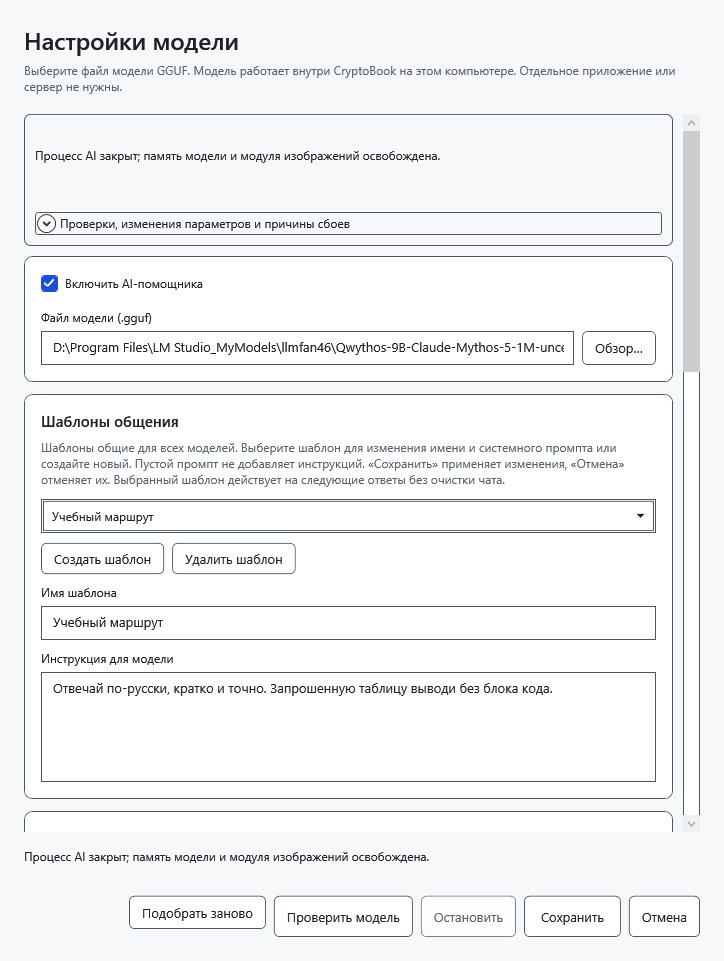
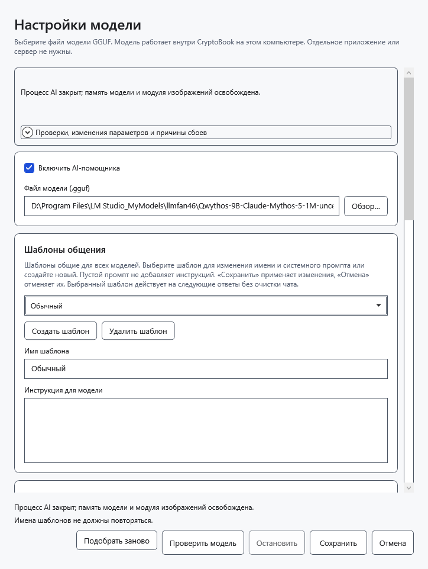
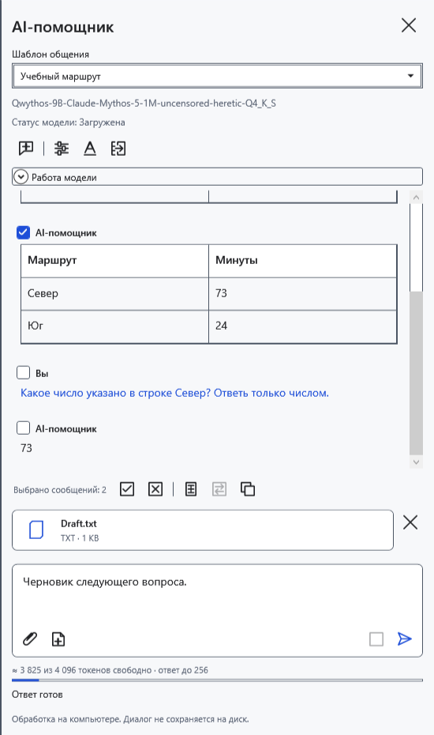
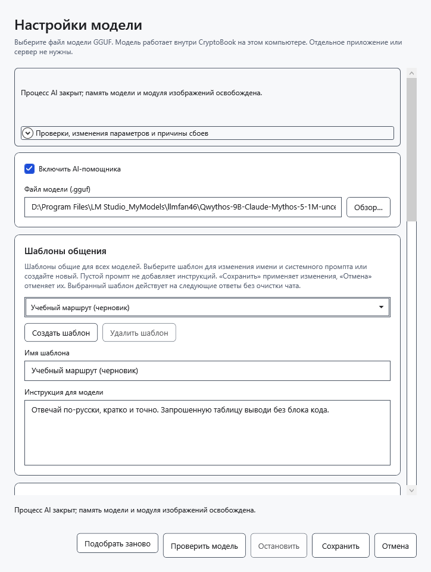

# Настроить общие шаблоны общения

Шаблон — общая инструкция для следующих запросов любой выбранной модели. Он не является отдельным чатом или профилем памяти. В поставке шесть вариантов: **Обычный**, **Краткие ответы**, **Подробные объяснения**, **Редактор текста**, **Аналитик**, **Помощник программиста**.

## Создать или изменить

1. В AI-панели откройте **Настройки модели** и прокрутите до **Шаблоны общения**.
2. Нажмите **Создать шаблон** либо выберите существующий вариант из списка.
3. Введите непустое уникальное **Имя шаблона**.
4. Заполните **Инструкция для модели**. Пустая инструкция допустима и не добавляет собственных указаний. Нажмите **Сохранить** для применения.

При пустом имени окно попросит его указать. Повторяющиеся имена, включая различие только регистром, не сохраняются. Исправьте имя и повторите **Сохранить**.

## Выбрать для следующего запроса

В верхней части панели выберите **Шаблон общения**. Выбор сохраняется и действует для всех моделей. Уже полученные ответы не переписываются; история, черновик, вложения и загруженные веса сохраняются. Во время ответа список в панели недоступен. Изменение шаблона в окне настроек действует со следующего запроса.

Инструкция задаёт желаемое поведение, но не гарантирует его соблюдение моделью. Имена встроенных вариантов переводятся вместе с интерфейсом; пользовательские имена и текст инструкций автоматически не переводятся. Сохранённые правки, добавления и удаления не заменяются исходным набором при обновлении. Старые инструкции отдельных моделей могут появиться как дополнительные общие шаблоны.

## Удалить или отменить

Выберите вариант и нажмите **Удалить шаблон**, затем **Сохранить**. Команда удаляет шаблон из общего набора. Последний оставшийся удалить нельзя.

**Отмена** или закрытие окна отбрасывает несохранённые создание, редактирование, удаление и выбор. После сохранения универсальной отмены удаления нет. Изменение только шаблонов сохраняет чат; изменение самой модели или других её параметров в том же окне может очистить диалог, поэтому сначала перенесите нужные ответы в документ.

- [Чат и выбор сообщений](help:ai.chat)
- [Выбор модели](help:ai.models)
- [Перенос ответа](help:ai.apply)
