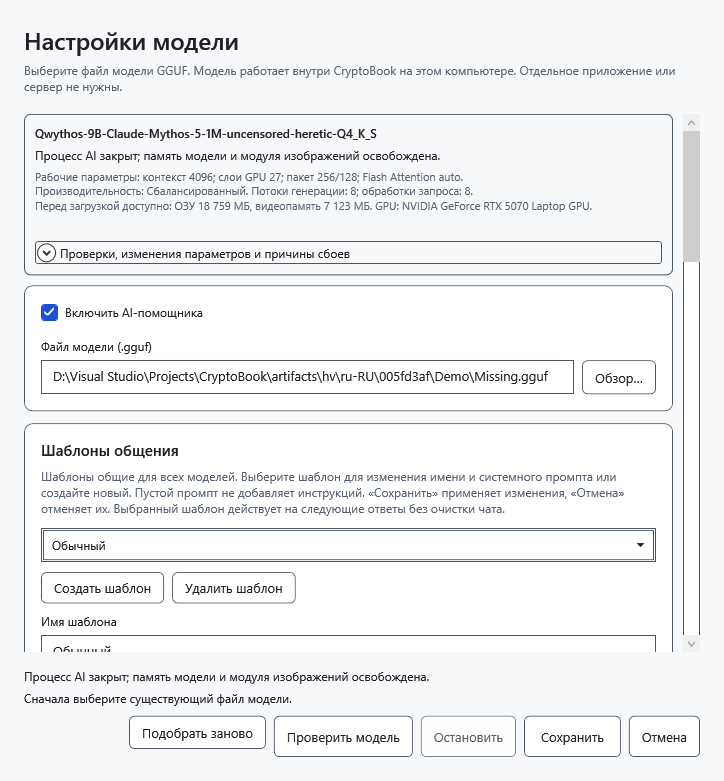

# Если AI-помощник не отвечает

Сначала прочитайте пояснение под полем запроса, текст ошибки и **Статус модели**. Они описывают разные вещи: загруженные веса могут оставаться в памяти после завершённого или остановленного ответа.

## Недоступна отправка

- Помощник выключен: откройте **Настройки модели**, отметьте **Включить AI-помощника**, выберите GGUF и сохраните.
- Пустой вопрос без вложений: введите вопрос. Во время чтения вложений дождитесь завершения.
- Предыдущий запрос выполняется: дождитесь ответа или нажмите **Остановить**.
- Рабочее пространство действительно заблокировано: сначала разблокируйте его прежним ключом. Само наличие сохранённого снимка не запрещает обычные запросы.

## Ошибка модели или изображения

Сообщение **Сначала выберите существующий файл модели.** означает, что путь пуст или файл недоступен. Подключите носитель либо выберите существующий файл. Ввод `mmproj` вместо языковой модели или неверный заголовок файла вызывает отказ формата. Переименование другого файла в `.gguf` не делает его моделью. Ошибка не сохраняет неверные настройки поверх прежних.

Текстовый ответ работает, а изображение нет: проверьте поддержку зрения, совместимость проектора и наличие ровно одного GGUF с `mmproj` в имени рядом с моделью. Не выбирайте его вместо модели. Ошибка кодировщика может означать несовместимость, повреждение картинки или недостаток памяти; попробуйте небольшую корректную картинку. Текстовая проверка модели не проверяет vision.

## Нехватка памяти, длинный чат или сбой

1. Если операция ещё активна, нажмите **Остановить** и дождитесь завершения. Для освобождения весов используйте **Выгрузить модель**.
2. Раскройте **Работа модели → Проверки, изменения параметров и причины сбоев**. Здесь видны выполненные попытки и фактические параметры; они могут отличаться от запрошенных при автоматическом подборе.
3. При нехватке памяти выберите меньшую модель или контекст; в дополнительных параметрах можно выбрать автоматическую память либо работу только в RAM. Это может снизить скорость. **Подобрать заново** в автоматическом режиме повторяет подбор; он не гарантирует успех любой модели.
4. Если диалог не помещается в контекст, сначала перенесите нужный ответ в документ, затем начните **Новый чат** или уменьшите вложения. Очистка необратимо удаляет переписку из памяти. Увеличение контекста требует больше памяти.

Пустой видимый ответ не обязательно означает выгрузку: увеличьте допустимую длину ответа и проверьте настройки рассуждений. Длительные буквальные повторы может остановить защита от повторов; она не обнаруживает любое смысловое повторение.

При сбое отдельного процесса документ остаётся открытым. Сохраните нужный частичный ответ и повторите запрос вручную после устранения причины. До появления текста автоматический подбор может повторить запуск с более безопасными параметрами; после частичного ответа автоматического повторения нет. Непредвиденный выход в простое меняет статус на **Выгружена**; новый запрос загружает модель снова. Остановка, явная выгрузка и сбой процесса — разные результаты.

- [Выбор и проверка модели](help:ai.models)
- [Остановка и выгрузка](help:ai.lifecycle)
- [Память](help:ai.memory)
- [Вложения](help:ai.attachments)
- [Восстановление после сброса ключа](help:recovery.lock)
