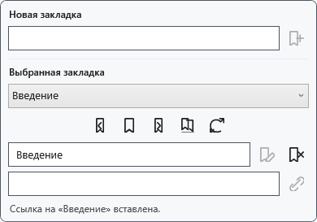
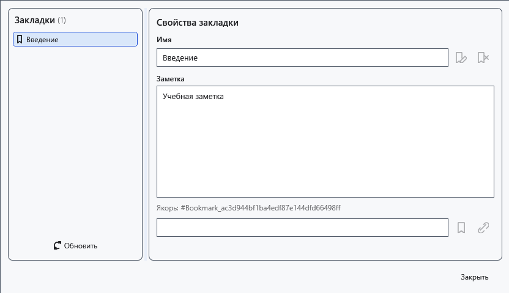

# Закладки, заметки и внутренние ссылки

Закладка отмечает место обычного документа. Сохраняйте документ в XamlPackage или защищённом формате CryptoBook: позиции закладок, имена, заметки и внутренние ссылки восстанавливаются при повторном открытии. Закладки, потерянные при сохранении в прежних версиях, автоматически не восстанавливаются.

## Порядок действий

1. Поставьте каретку и раскройте **Закладки** над документом. Введите имя и нажмите **Добавить в позиции каретки**.
2. Выберите закладку в списке. **Перейти к выбранной закладке**, **Предыдущая закладка** и **Следующая закладка** располагают строку закладки по центру видимой области редактора и ненадолго подсвечивают её. У начала и конца документа прокрутка ограничена его краями. Соседние переходы обходят документ по кругу; внутренние ссылки также центрируют и подсвечивают место закладки.
3. Для переименования введите новое имя и нажмите **Переименовать выбранную закладку**. Для ссылки поставьте каретку в другом месте, задайте текст и нажмите **Вставить ссылку на выбранную закладку**.
4. Откройте **Открыть диспетчер закладок**: выберите запись и измените заметку. **Обновить индекс из документа** перечитывает якоря текущего документа.

## Проверка, отмена и ограничения

Проверьте переход и имя. **Удалить выбранную закладку** убирает якорь, а не файл документа. Пустое или занятое имя исправьте по сообщению в панели. Закрытие диспетчера не означает отмену уже внесённых изменений; сохраните документ явно. Если закладка пропала после переноса/удаления текста, обновите индекс. TXT, XAML и RTF не гарантируют сохранение якорей и заметок.

## Связанные темы

- [Внешние ссылки и подписи](help:edit.links)
- [Дерево структуры документа](help:content.structure)
