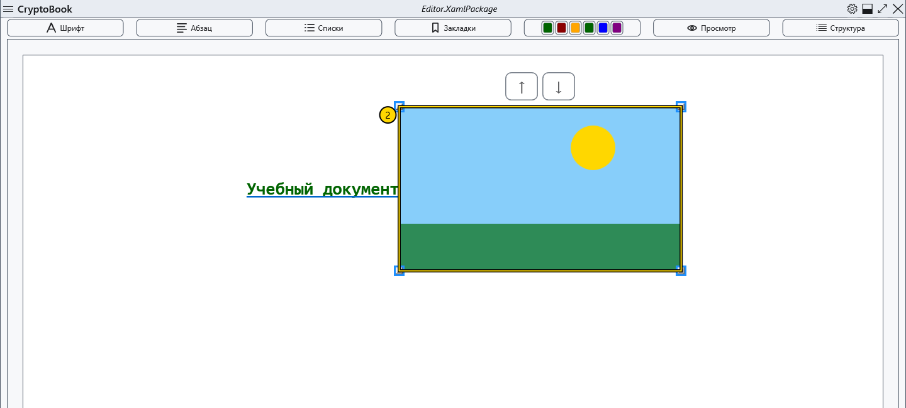
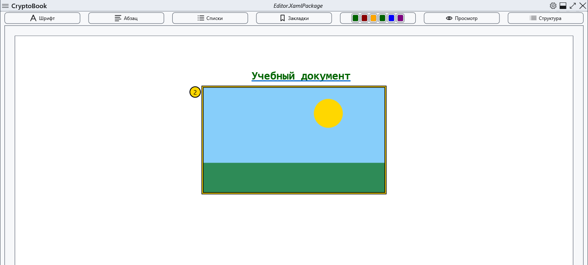
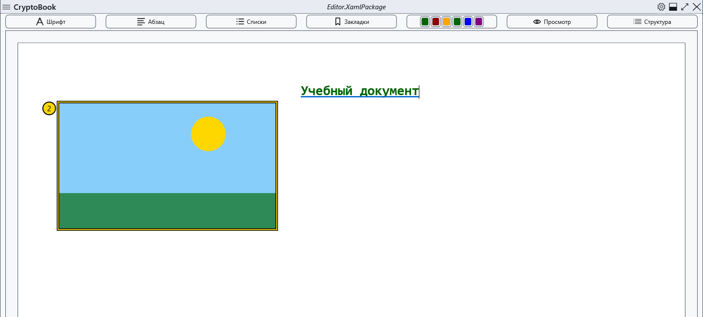
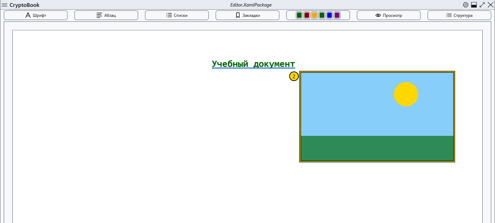

# Встроенные изображения

Изображение вставляется в обычный документ. Сначала откройте расходную копию в редактировании; для полного сохранения размещения используйте XamlPackage.

## Порядок действий

1. Поставьте каретку, откройте меню **Содержимое** → команду вставки изображения или соответствующий пункт контекстного меню. Выберите файл; отмена выбора не меняет документ.
2. Щёлкните изображение: появятся маркеры изменения размера. Перетаскивайте маркер, проверяя пропорции и границы листа.
3. В контекстном меню изображения выберите размещение: в строке, отдельным блоком по центру, с обтеканием слева или справа. Ниже показаны четыре результата в этом порядке.

## Проверка, отмена и ограничения

Перетаскивание меняет позицию; команды выше/ниже и Alt+↑/↓ перемещают выбранное изображение при допустимом соседнем месте. Delete удаляет вставку, Esc снимает выбор; исходный файл изображения остаётся на диске. Отмена удаления не гарантирует восстановления самого изображения. Сохраните копию заранее; если Ctrl+Z не вернул изображение, вставьте исходный файл заново. После сохранения откройте копию и проверьте размеры и размещение. В Markdown используйте относительную ссылку на локальное изображение, а не эту команду.

## Связанные темы

- [Фон и кадрирование страницы](help:content.background)
- [Форматы и кодировки](help:doc.formats)
