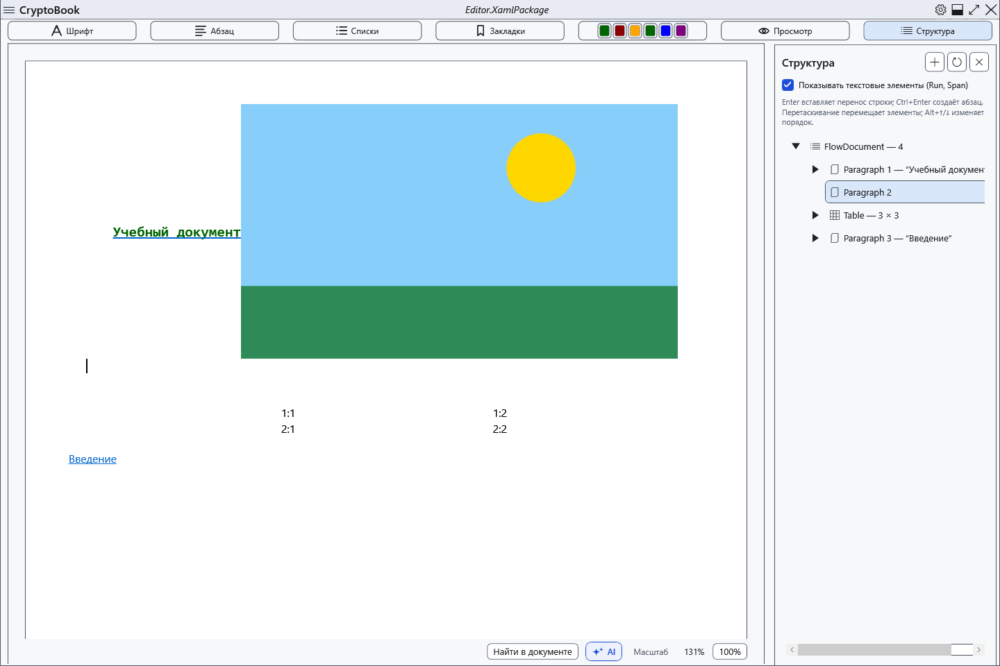

# Дерево структуры документа

Панель структуры помогает находить и переставлять части обычного документа. Используйте копию перед удалением крупных фрагментов.

## Порядок действий

1. Нажмите **Структура** над документом. Раскройте узлы дерева; включите отображение текстовых элементов для подробного состава. Обновите дерево после изменений при необходимости.
2. Выберите узел для перехода. Через контекстное меню добавьте абзац до, внутри или после допустимого элемента; кнопка добавления и Ctrl+Enter используют текущий выбор.
3. Команды вверх/вниз, Alt+↑/↓ и перетаскивание меняют порядок, если новое место допускает такой элемент. Удаление узла удаляет его содержимое из документа.

## Проверка, отмена и ограничения

Проверьте текст в редакторе и соседние узлы. Ctrl+Z отменяет доступные изменения редактора; закрытие панели ничего не отменяет. Не все элементы можно удалить или вложить друг в друга: корень и защищённые якоря имеют ограничения. В просмотре навигация и изменение через дерево отключены; вернитесь в редактирование. После сложной перестановки сохраните копию XamlPackage и откройте её повторно.

## Связанные темы

- [Основные операции с текстом](help:edit.basic)
- [Редактирование существующей таблицы](help:content.tables)
