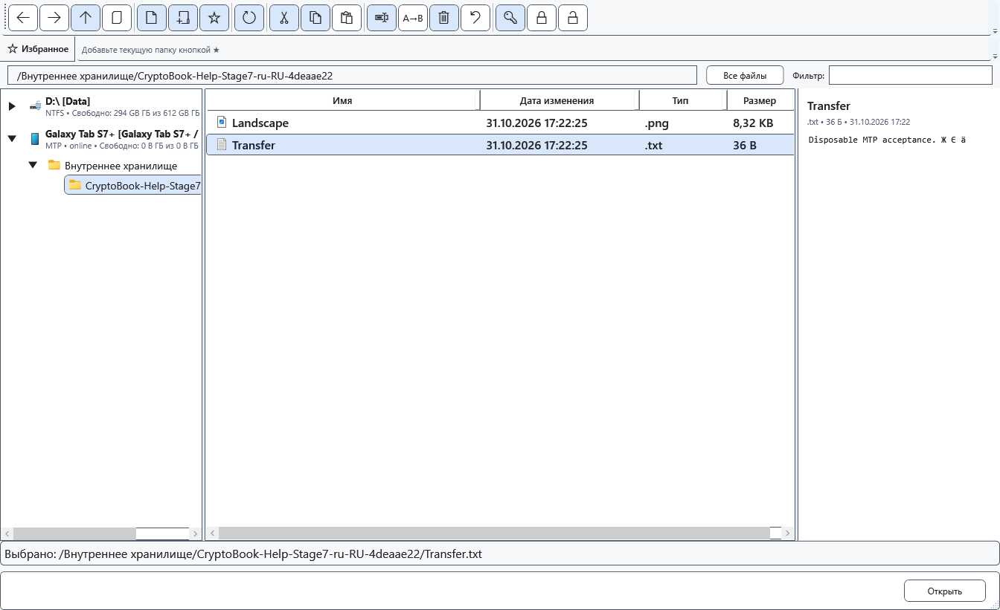

# Подключение Android

Android можно использовать как дополнительный источник файлов. Обычное подключение использует передачу файлов MTP через Windows; режим разработчика и ADB для этого не нужны.

## Перед началом

Нужны кабель с передачей данных, разблокированное устройство и разрешённый доступ к общей памяти. Видимость папок зависит от Android и прав устройства; защищённые каталоги приложений не открываются автоматически.

## Порядок действий

1. Подключите устройство к компьютеру, разблокируйте его и выберите на Android режим передачи файлов. Подписи USB-режимов зависят от производителя.
2. Откройте файловый менеджер CryptoBook. В дереве источников выберите подключённое устройство, затем доступную общую память и папку.
3. Проверьте список и доступность команд на одном ненужном тестовом файле. Начните с копирования, сохраняя оригинал.
4. После завершения операций закройте обращения к устройству и отключите его. При повторном подключении заново выберите источник и папку.

## Проверка результата

В дереве появляется источник устройства и доступные ему папки. Это источник файлов, а не локальная рабочая папка поиска. Не все команды локального диска доступны на устройстве.

## Отмена и возврат

До завершения передачи используйте отмену в окне прогресса и дождитесь остановки. Не считайте отсоединение кабеля способом отмены.

## Если не получилось

Источник не появился — проверьте разблокировку, USB-режим, кабель и видимость в Windows, затем повторно подключите устройство. ADB — отдельный необязательный способ: он требует настройки отладки и разрешения компьютера; состояния offline/unauthorized означают, что доступ ещё не готов.

## Связанные темы

- [Передача файлов между компьютером и Android](help:devices.transfers)
- [Возможности и ограничения устройств](help:devices.limits)
