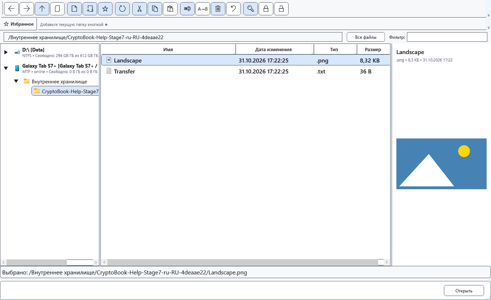
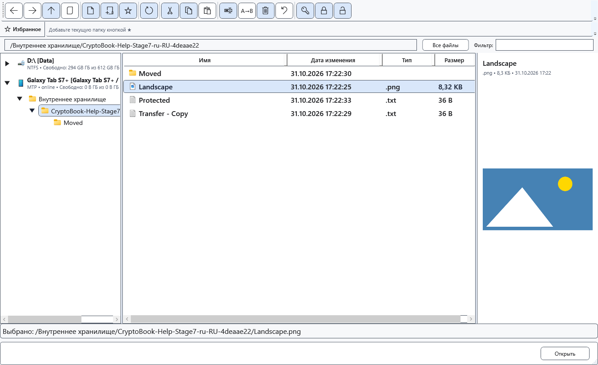

# Возможности и ограничения устройств

Набор команд зависит от выбранного источника, объекта и его прав. Android служит дополнительным диском для файлов; его нельзя приравнивать ко всем возможностям локального Windows-диска.

## Перед началом

> Удаление на Android безвозвратно с точки зрения CryptoBook. Команда восстановления локальных операций и корзина Windows не возвращают удалённые объекты устройства. Расшифрованный результат хранится без защиты.

| Действие | Локальная папка | Android/MTP |
| --- | --- | --- |
| Навигация, копирование, перенос, создание папок, переименование | По правам папки | По правам устройства и объекта |
| Удаление из файлового менеджера | Корзина Windows с подтверждением | Постоянное, с подтверждением |
| Поиск рабочей папки, мониторинг, групповое переименование | Доступны при своих условиях | Не поддерживаются как локальные команды |
| Внешнее открытие, полный отчёт свойств и хешей | Доступны при своих условиях | Сначала скопируйте локально |
| Краткий просмотр текста/изображений | Поддерживаемые файлы | Через поток, без автоматического расшифрования |

## Порядок действий

1. Для полного просмотра или подробных свойств скопируйте файл устройства в локальную папку и работайте с копией.
2. Чтобы расшифровать файл на самом устройстве, введите подходящий ключ, выберите один читаемый защищённый файл и команду **Расшифровать выбранные элементы**.
3. В окне **Расшифровка документа** выберите доступный формат и **Заменить защищённый исходник расшифрованным файлом**, если требуется результат на устройстве. Нужны права записи и удаления; проверьте предупреждение перед подтверждением.
4. Если требуется сохранить защищённый оригинал, выберите сохранение расшифрованной копии и явно проверьте её назначение.

## Проверка результата

При успешной замене результат находится в папке устройства. Его имя и расширение могут отличаться от защищённого файла. Доступ к расшифрованию читаемого удалённого файла не требует отдельного разрешения на шифрование.

## Отмена и возврат

До подтверждения закройте окно параметров. После записи не рассчитывайте на универсальную отмену; храните отдельную защищённую копию, если она нужна.

## Если не получилось

Недоступная команда обычно означает неподходящий объект, отсутствующий ключ или права. Записываемые файлы Android могут разрешать шифрование/защищённую копию по своим правам, но это не означает поддержку рекурсивного шифрования удалённой папки. Подробный цикл защиты описывается отдельно.

## Связанные темы

- [Подробные свойства и хеши](help:files.properties)
- [Расшифрование файлов](help:security.decrypt)
