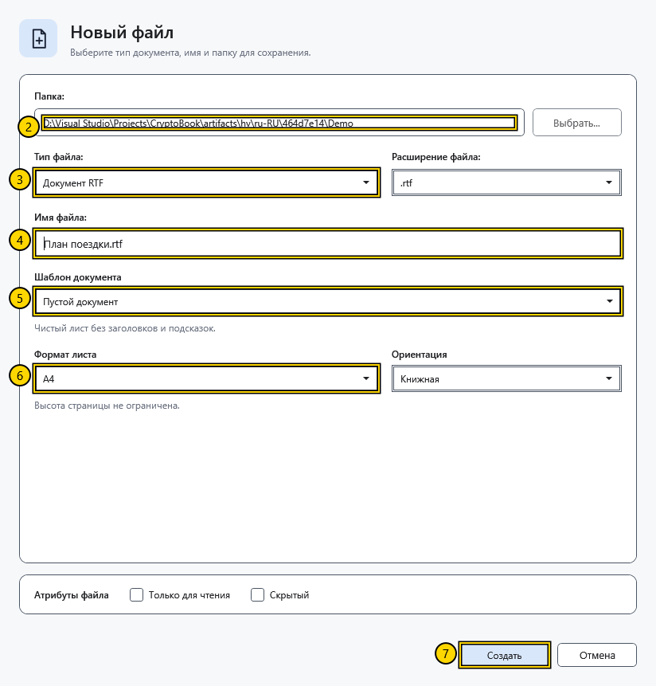
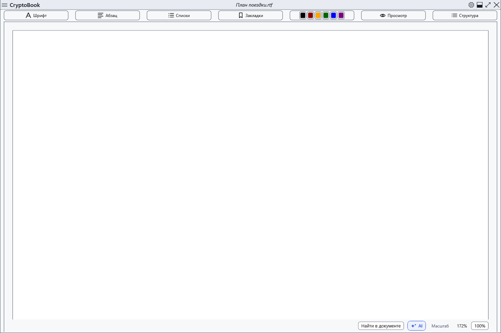
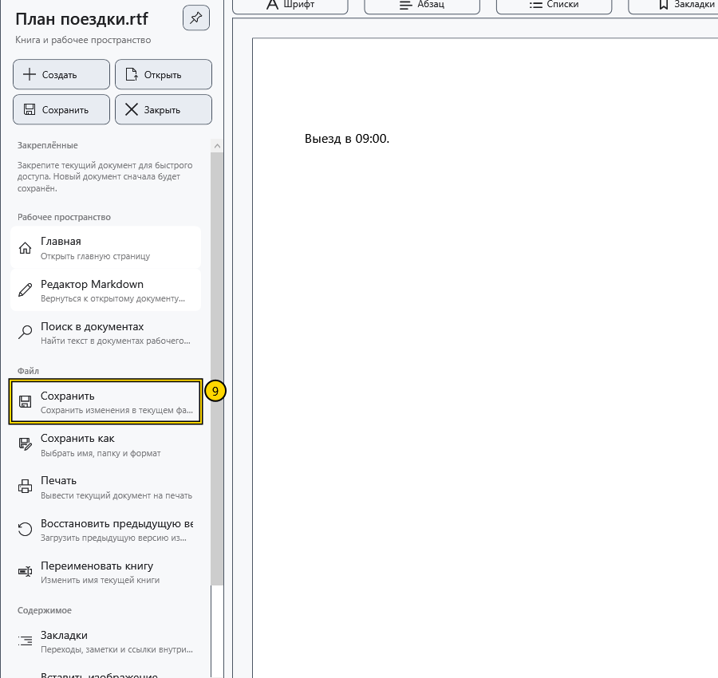
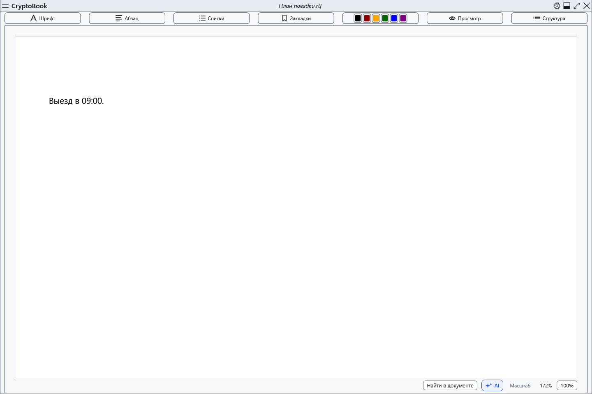

# Создать и сохранить документ

Создайте пустой RTF-файл, добавьте короткую строку и сохраните изменения. RTF подходит для обычного документа с оформлением текста.

## Перед началом

Используйте локальную папку, в которой можно создавать файлы, и незанятое имя. В примере создаётся **План поездки.rtf**. Перед началом сохраните изменения в уже открытом документе. RTF-файл не защищён паролем.

## Порядок действий

1. На начальном экране нажмите **Новый документ**. Если документ уже открыт, воспользуйтесь быстрым действием **Создать** в боковом меню.
2. В поле **Папка:** нажмите **Выбрать...** и укажите демонстрационную папку.
3. В поле **Тип файла:** выберите **Документ RTF** и проверьте **.rtf** в поле **Расширение файла:**.
4. В поле **Имя файла:** введите **План поездки.rtf**. Вводите имя после выбора типа: смена типа заменяет предлагаемое имя.
5. В поле **Шаблон документа** выберите **Пустой документ**.
6. Установите **Формат листа** — **A4**, **Ориентация** — **Книжная**. Для этого примера оставьте флажки **Только для чтения** и **Скрытый** снятыми.

7. Нажмите **Создать**. Дождитесь открытия нового файла в обычном редакторе и проверьте его имя в верхней строке.

8. Щёлкните по странице и введите **Выезд в 09:00.**
9. Откройте боковое меню и в разделе **Файл** нажмите **Сохранить**. Можно также нажать **Ctrl+S**, когда фокус находится в редакторе.

## Проверка результата

Ещё раз откройте тот же RTF-файл быстрым действием **Открыть** в боковом меню. Строка **Выезд в 09:00.** должна остаться на странице. Проверьте фактическое имя документа, если из-за совпадения программа подобрала другое свободное имя.

## Отмена и возврат

До нажатия **Создать** можно выйти из диалога кнопкой **Отмена**. После создания закрытие документа не удаляет файл. Для другого имени или папки используйте **Файл → Сохранить как**; при смене типа файла состав сохраняемого оформления может измениться.

## Если не получилось

Если **Создать** недоступно, проверьте выбор папки, типа и имени, а также возможность записи в папку. При ошибке прочитайте сообщение и исправьте имя или выберите другую папку. Если появилось **Файл создан, но его не удалось открыть.**, сначала проверьте папку: файл уже мог появиться. **Сохранить** может быть недоступно, когда новых изменений нет или обычный документ открыт в режиме чтения.

## Связанные темы

- [Основные области окна](help:start.interface)
- [Сохранить и «Сохранить как»](help:doc.save)
