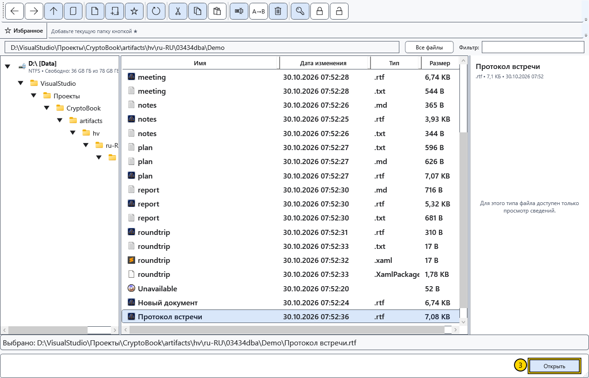

# Открыть документ

Откройте существующий файл, чтобы читать или редактировать его. Обычный документ и Markdown занимают два независимых редактора; открытие другого файла того же вида заменяет документ в соответствующем редакторе.

## Перед началом

Сохраните нужные изменения. Если при замене документа появится вопрос о сохранении, отмена оставит текущий документ открытым. Для защищённого файла нужен подходящий ключ; другие форматы направляются в соответствующие средства просмотра.

## Порядок действий

1. Нажмите **Открыть файл** на начальном экране или **Открыть** в быстрых действиях бокового меню.
2. В файловом менеджере перейдите в папку файла. Путь в адресной строке относится к этому окну и может отличаться от рабочей директории.

3. Выделите один файл и воспользуйтесь **Открыть** либо дважды щёлкните по нему. Для папки то же действие показывает её содержимое.
4. Если появился вопрос о несохранённых изменениях, выберите сохранение, продолжение без сохранения или отмену. При ошибке сохранения не закрывайте исходный документ: сначала устраните причину или сохраните копию.

## Где откроется файл

| Содержимое | Результат |
| --- | --- |
| RTF, XamlPackage и обычные текстовые файлы | Обычный редактор на странице **Главная** |
| Markdown | **Редактор Markdown** с исходным текстом и просмотром |
| Поддерживаемые изображения и видео | Соответствующий просмотр или медиаплеер |
| PDF | Внешняя программа, назначенная в Windows |
| Защищённый файл CryptoBook | Открытие после проверки формата и подходящего ключа |

Расширение само по себе не превращает содержимое в другой формат. Не переименовывайте произвольный файл в `.rtf` или `.cbook` для его преобразования. Двойной щелчок в Проводнике Windows зависит от установленных файловых ассоциаций.

## Проверка результата и возврат

Сверьте имя в верхней строке и несколько строк содержимого. Возвращайтесь к другому редактору через **Рабочее пространство → Главная / Редактор Markdown**. Закрытие файлового менеджера не закрывает документ, уже открытый в главном окне.

В окне выбора папки или файла кнопка подтверждает выбор для вызвавшего его действия; это отличается от обычного файлового менеджера. **Отмена** прекращает выбор. Если файл не открывается, проверьте подключение диска, доступ на чтение, действительный формат и необходимость ключа. Сообщение об ошибке не подтверждает успешное открытие.

## Связанные темы

- [Форматы и кодировки](help:doc.formats)
- [Два редактора, переименование и закрытие](help:doc.switch)
- [Сохранить и «Сохранить как»](help:doc.save)
- [Совместимость защищённых файлов](help:security.compatibility)
