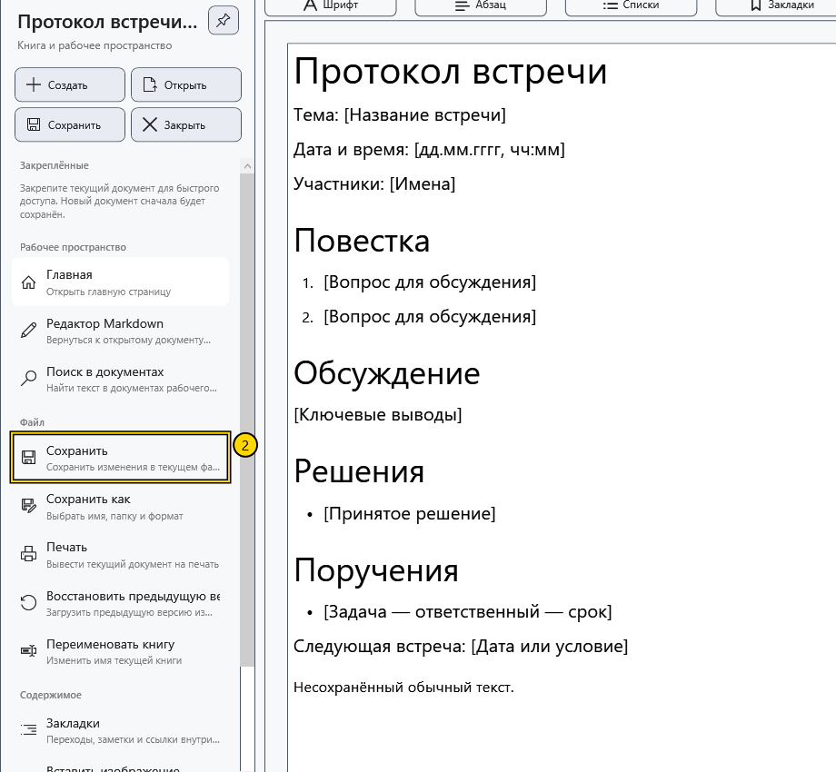
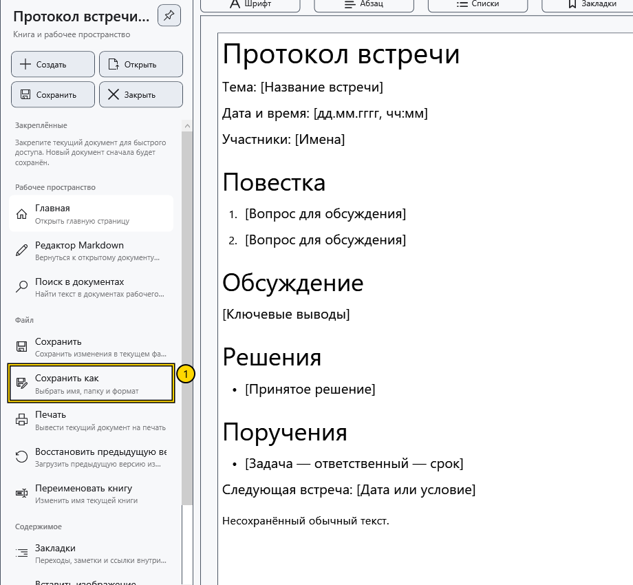
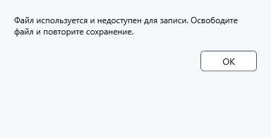

# Сохранить и «Сохранить как»

**Сохранить** записывает изменения активного документа по его текущему пути. **Сохранить как** выбирает другое имя, папку или формат и после успешной записи делает новый путь текущим.

## Перед началом

Проверьте имя в верхней строке и активный редактор. Обычный документ и Markdown сохраняются независимо.

> Перед заменой существующего файла или переходом в текстовый формат сохраните нужный оригинал отдельно. Текстовый экспорт теряет оформление; отдельный вопрос о такой потере появляется не во всех случаях.

## Сохранить текущий файл

1. Измените документ.
2. Откройте боковое меню и нажмите **Сохранить** в быстрых действиях либо **Файл → Сохранить**. В редакторе можно использовать **Ctrl+S**.
3. Дождитесь окончания записи. Для документа без пути потребуется выбрать назначение.

Если новых изменений нет, команда может быть недоступна. Для обычного документа в режиме чтения сначала вернитесь к редактированию.

## Сохранить в другое место или формат

1. Выберите **Файл → Сохранить как** или **Ctrl+Shift+S** в редакторе.

2. В системном диалоге выберите папку, имя и тип файла. Проверьте расширение: оно также влияет на выбранный формат. Подтверждение перезаписи заменяет существующий файл. Подписи системного диалога зависят от языка Windows.
3. Подтвердите запись и проверьте новое имя в верхней строке. Дальнейшее **Сохранить** относится к новому пути; старый файл не получает последующие изменения.

Обычный оформленный документ нельзя экспортировать прямо в Markdown. В Markdown доступны сохранение исходника и его текстовая копия; видимый предпросмотр не заменяет исходный текст при сохранении.

## Несохранённые изменения

При закрытии изменённого документа или замене его другим файлом вопрос предлагает три решения. Утвердительный ответ сохраняет изменения и продолжает действие. Отрицательный продолжает без записи последних правок. Отмена сохраняет документ открытым и прекращает действие. Подписи этих системных кнопок зависят от Windows.

Если сохранение отменено или не удалось, закрытие или замена не должны завершаться. При выходе из программы проверяются оба редактора. Переход между уже открытыми обычным документом и Markdown не требует отбрасывать их изменения.

## Проверка результата

Закройте сохранённый демонстрационный файл и откройте его снова. Проверьте последние строки и нужное оформление. Наличие файла с правильным расширением не доказывает, что последнее сохранение завершилось.

## Отмена и ошибки

**Отмена** в выборе назначения оставляет путь и несохранённый текст прежними. Не закрывайте редактор после ошибки записи. Освободите файл в другой программе, проверьте место на диске и доступ к папке, затем повторите **Сохранить** или выберите другое назначение через **Сохранить как**.

Для защищённого сохранения требуется ключ и отдельное подтверждение. Наличие ключа также может вызвать предложение создать защищённую копию обычного файла: читайте выбранное действие и итоговый путь. Не считайте любой сохранённый RTF или TXT зашифрованным.

## Связанные темы

- [Форматы и кодировки](help:doc.formats)
- [Два редактора, переименование и закрытие](help:doc.switch)
- [Ошибки записи и восстановление](help:recovery.write)
- [Шифрование документов](help:security.protect)
