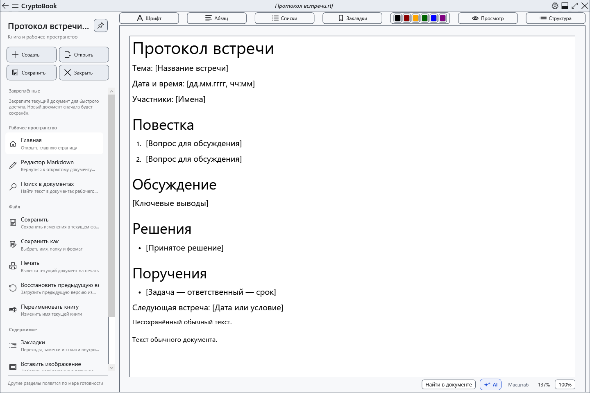
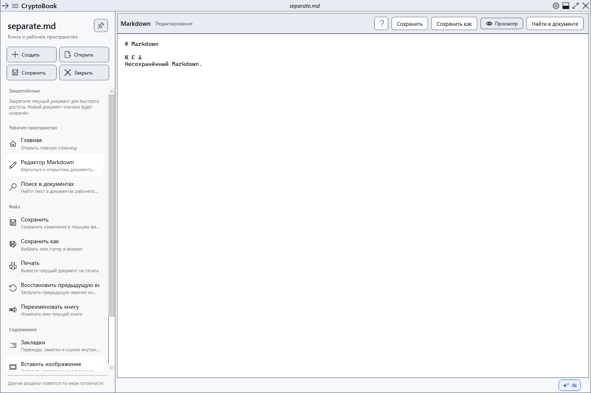
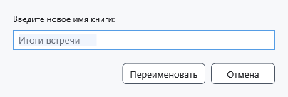

# Два редактора, переименование и закрытие

CryptoBook держит обычный документ и Markdown независимо. Например, можно оставить заметки RTF на странице **Главная**, открыть план Markdown и вернуться к заметкам вместе с несохранёнными изменениями. Это два редактора, а не неограниченный набор вкладок.

## Переключиться между документами

1. Откройте обычный документ, затем Markdown через **Открыть**.
2. Откройте боковое меню **Рабочее пространство** и выберите **Главная** или **Редактор Markdown**. Команда Markdown доступна, когда такой документ уже открыт.

3. Сверьте имя в верхней строке перед **Сохранить**. Сохранение одного редактора не сохраняет второй.

Стрелки назад и вперёд в верхней строке переключают уже открытые страницы приложения. Они не отменяют правки и не возвращают предыдущий файл после замены документа другим файлом того же вида. При такой замене несохранённые изменения проверяются отдельно.

## Переименовать книгу

1. Выберите нужный редактор и откройте **Файл → Переименовать книгу**.
2. Введите новое имя и подтвердите **Переименовать**. Расширение сохраняется; менять формат этой командой нельзя.

Для файла на диске меняется его имя в той же папке. Для документа без пути меняется имя текущей сессии; файл появится только после сохранения. Переименование не заменяет сохранение последних правок. **Отмена** оставляет имя прежним. Если имя занято или недопустимо либо файл заблокирован, исправьте причину и проверьте фактическое имя после сообщения об ошибке.

## Закрыть документ или программу

Быстрое действие **Закрыть** относится к активному документу. При несохранённых изменениях выберите сохранение, продолжение без записи или отмену. Отмена оставляет документ открытым; отказ от сохранения теряет последние правки этого документа. Успешное закрытие одного редактора не закрывает независимый второй документ.

Крестик главного окна завершает приложение и проверяет изменения обоих редакторов. Ошибка или отмена сохранения прерывает закрытие. Закрытие документа не удаляет его файл с диска. Чтобы вернуться, откройте сохранённый файл заново; несохранённые и отброшенные изменения этим не восстанавливаются.

## Проверка результата

Внесите разные строки в расходные RTF и Markdown, переключитесь в обе стороны и убедитесь, что тексты не смешались. Сохраните каждый отдельно и повторно откройте их. Если отображается неожиданный файл, сначала проверьте активную страницу и имя, затем выполняйте сохранение или переименование.

## Связанные темы

- [Открыть документ](help:doc.open)
- [Сохранить и «Сохранить как»](help:doc.save)
- [Закреплённые документы](help:files.pinned)
- [Недавние документы](help:files.recent)
