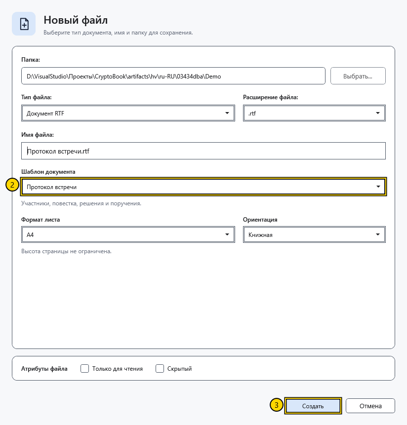

# Выбрать шаблон документа

Шаблон заполняет новый файл начальным содержимым. Например, **Протокол встречи** даёт заготовку для повестки и решений. Тип файла определяет способ хранения, а шаблон — начальный текст.

## Порядок действий

1. Нажмите **Новый документ** на начальном экране или **Создать** в боковом меню. Выберите папку, тип файла и имя.
2. В поле **Шаблон документа** выберите заготовку. Прочитайте её описание под списком.

3. При необходимости задайте формат листа и ориентацию, затем нажмите **Создать**. Для Markdown параметры листа скрыты.

| Шаблон | Когда использовать |
| --- | --- |
| Пустой документ | Начать без заготовленного текста |
| Заметки | Собрать короткие записи |
| План проекта | Разложить работу по этапам |
| Протокол встречи | Записать обсуждение, решения и задачи |
| Дневник | Сделать личную запись |
| Отчёт | Подготовить структурированный итог |

В RTF и XamlPackage шаблон преобразуется в оформленный документ. В текстовом файле оформление теряется. В Markdown остаётся исходный текст с разметкой. Язык нового содержимого соответствует языку приложения в момент создания; уже записанный файл смена языка не переводит.

## Шаблон по умолчанию

Откройте **Настройки → Оформление → Шаблон нового документа по умолчанию**. Выбор применяется к следующему диалогу создания; существующие документы и уже открытый диалог он не перезаписывает. В каждом новом диалоге можно выбрать другой шаблон.

## Проверка результата и отмена

После создания проверьте заголовки и текст в открытом файле. Для проверки сохранения закройте файл и откройте его снова. До создания нажмите **Отмена**; файл не появится. После создания отмена диалога не удаляет уже записанный файл.

Если ожидалось оформление, проверьте тип файла: **Текстовый файл** и **XAML-файл** сохраняют только текст. Изменение шаблона по умолчанию не заменяет текст текущего документа.

## Связанные темы

- [Создать и сохранить документ](help:doc.create)
- [Форматы и кодировки](help:doc.formats)
- [Настройки оформления](help:settings.appearance)
