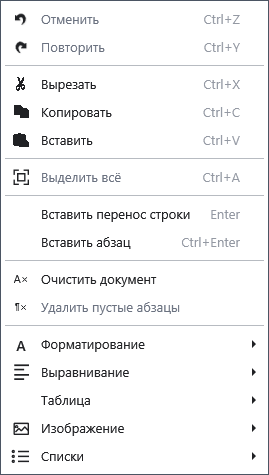

# Основные операции с текстом

Выделите фрагмент, чтобы заменить, скопировать или удалить его. Команды работают в обычном редакторе; сначала щёлкните по тексту документа.

## Порядок действий

1. Выделите текст мышью или Shift со стрелками. Ctrl+A выделяет весь документ.
2. Откройте контекстное меню: **Копировать** (Ctrl+C), **Вырезать** (Ctrl+X), **Вставить** (Ctrl+V). Вставка заменяет выделенный фрагмент.
3. Для исправления используйте **_Отменить** (Ctrl+Z) и **_Повторить** (Ctrl+Y). Enter переносит строку внутри текущего абзаца; Ctrl+Enter создаёт новый абзац.

## Проверка, отмена и ограничения

**О_чистить документ** удаляет всё содержимое текущего документа; сначала сохраните нужную копию. **Удалить _пустые абзацы** убирает пустые абзацы, поэтому промежутки могут исчезнуть. Проверьте текст и отмените неудачное изменение до продолжения работы. История отмены не заменяет резервную копию файла. Если команда недоступна, проверьте выделение, фокус и режим редактирования.

## Связанные темы

- [Шрифт, цвет и выделение](help:edit.font)
- [Дерево структуры документа](help:content.structure)
