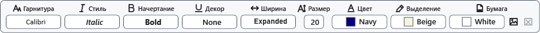

# Шрифт, цвет и выделение

Панель **Шрифт** меняет оформление выделенного текста. Без выделения параметры применяются к последующему вводу. Откройте обычный документ в режиме редактирования.

## Порядок действий

1. Выделите нужный фрагмент и раскройте **Шрифт** над документом.
2. Выберите **Гарнитура**, **Стиль**, **Начертание**, **Декор**, **Ширина** и **Размер**.
3. **Цвет** задаёт цвет букв, **Выделение** — фон выделения. Цвет бумаги меняется отдельно. Чтобы убрать оформление, используйте **_Очистить форматирование** в контекстном меню.

## Проверка, отмена и ограничения

Проверьте вид именно выбранного фрагмента. Ctrl+Z отменяет изменение. Наличие семейства и начертаний зависит от установленных шрифтов. Для сохранения оформления используйте RTF или XamlPackage и проверьте повторное открытие копии. TXT и текущий обработчик XAML сохраняют текст без этого оформления; Markdown оформляется своей разметкой.

## Связанные темы

- [Палитра чернил](help:edit.palette)
- [Форматы и кодировки](help:doc.formats)
