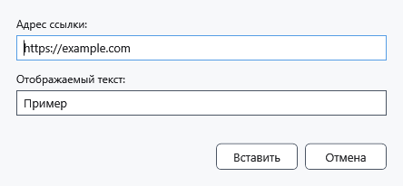

# Внешние ссылки и подписи

Ссылка связывает видимый текст с веб-адресом. Для внутреннего перехода к месту документа используйте ссылку на закладку.

## Порядок действий

1. Выделите будущую подпись или поставьте каретку. В **Абзац** нажмите **Вставить гиперссылку**.
2. В поле **Адрес ссылки:** введите адрес HTTP/HTTPS. При отсутствии схемы добавляется https://. В **Отображаемый текст:** укажите подпись; пустая подпись заменяется адресом.
3. Нажмите **Вставить**. Проверьте подпись и переход в режиме просмотра: внешняя ссылка открывается через системное приложение.

## Проверка, отмена и ограничения

**Отмена** закрывает диалог без вставки, Ctrl+Z отменяет вставленную ссылку. Некорректный адрес оставляет диалог открытым: исправьте адрес. В этом диалоге доступны веб-адреса; правила ссылок Markdown описаны отдельно. Сохраняйте оформленный документ в RTF/XamlPackage и проверяйте переход после повторного открытия; ограничения сохранения закладок описаны отдельно.

## Связанные темы

- [Закладки, заметки и внутренние ссылки](help:content.bookmarks)
- [Просмотр Markdown, ссылки и изображения](help:md.preview)
