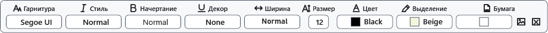

# Параметры и цвет страницы

Размер листа влияет на ширину текста и страницы просмотра. Цвет бумаги относится к документу и отличается от темы интерфейса.

## Порядок действий

1. При создании обычного документа выберите формат листа и ориентацию в диалоге создания. Эти параметры задаются до подтверждения; отдельной команды смены формата и ориентации открытого документа нет.
2. В открытом документе раскройте **Шрифт**. В области **Бумага** выберите **Фоновый цвет документа** либо изображение фона.
3. Переключитесь в просмотр, чтобы проверить страницы. Редактирование использует непрерывную высоту листа; границы страниц просмотра зависят от выбранного размера и содержимого.

## Проверка, отмена и ограничения

Отмените изменение цвета через Ctrl+Z. Чтобы изменить исходный формат листа, создайте новый документ с нужными параметрами и перенесите содержимое, сохранив оригинал. Для цвета, фона и параметров страницы используйте XamlPackage: RTF не сохраняет все параметры листа, TXT/XAML теряют оформление. Не принимайте изменение масштаба за изменение размера бумаги.

## Связанные темы

- [Фон и кадрирование страницы](help:content.background)
- [Просмотр, страницы и масштаб](help:edit.view)
- [Создать и сохранить документ](help:doc.create)
