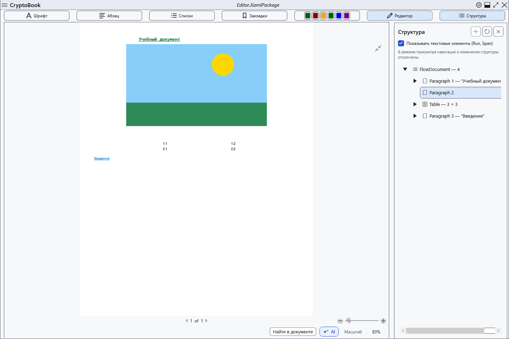

# Просмотр, страницы и масштаб

Обычный документ имеет режим редактирования и постраничный просмотр. Просмотр позволяет оценить расположение текста, сохраняя исходный документ.

## Порядок действий

1. Над документом нажмите **Просмотр**. Вернуться можно кнопкой **Редактор**.
2. В редакторе Ctrl+колесо мыши меняет масштаб, кнопка **100%** внизу возвращает фактический масштаб. Индикатор показывает текущий процент.
3. В просмотре используйте кнопку вписывания листа и стандартные элементы масштаба. При фокусе на просмотрщике ←/PageUp и →/PageDown меняют страницу, Home/End переходят к первой/последней.

## Проверка, отмена и ограничения

Проверьте процент и номер страницы; содержимое при переключении остаётся прежним. Режим просмотра не даёт редактировать дерево структуры; вернитесь в редактор для изменений. Вписывание пересчитывается при изменении окна. Масштаб экрана не меняет размер листа, шрифт в файле или параметры печати. Markdown использует другой просмотр, без редактирования результата.

## Связанные темы

- [Параметры и цвет страницы](help:edit.page)
- [Печать документа](help:view.print)
