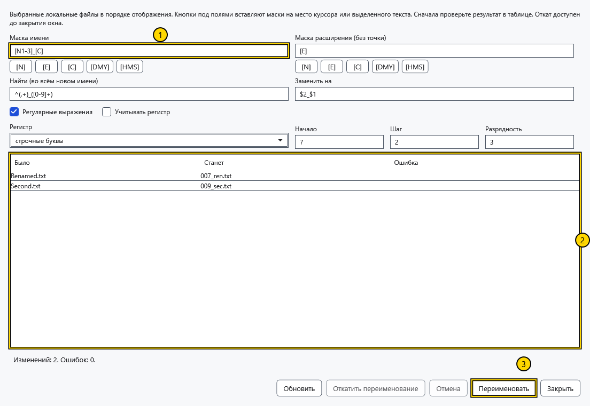
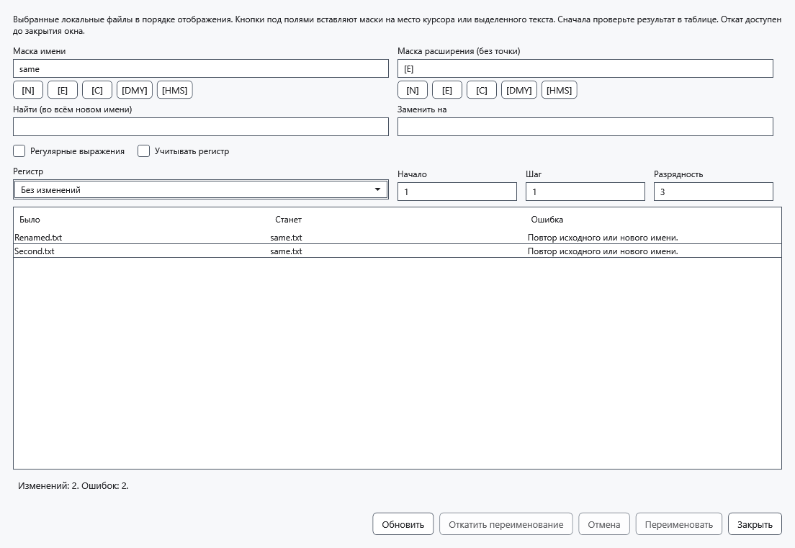
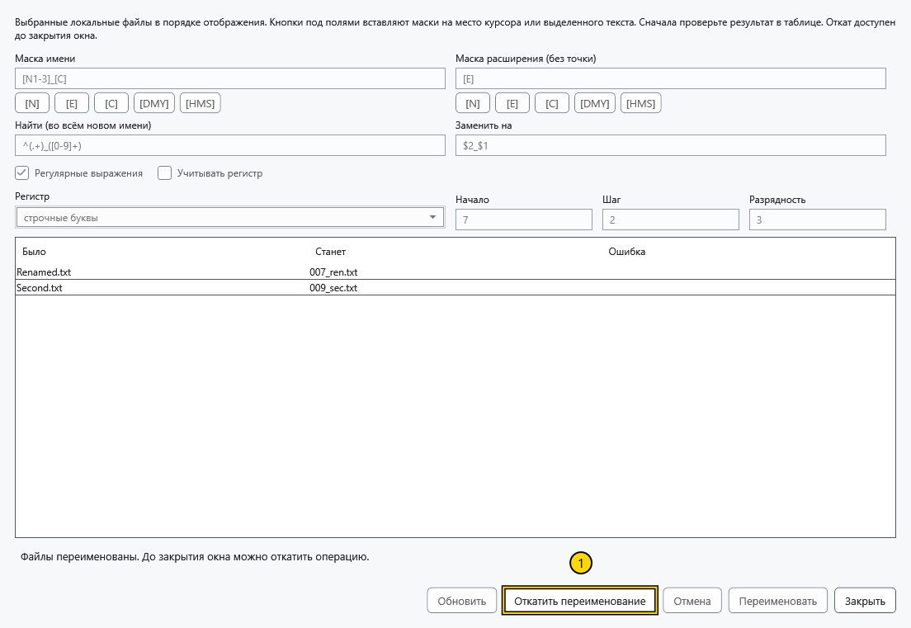

# Групповое переименование

Инструмент меняет по одному плану имена не менее двух локальных файлов. Папки и объекты Android/MTP не поддерживаются. Для важных файлов сохраните отдельную копию: отмена и восстановление зависят от доступа к папкам.

## Подготовить имена

1. Выделите в менеджере два и более локальных файла. Сначала отсортируйте список: счётчик следует видимому порядку, а не порядку выделения. Нажмите Ctrl+M, A→B или **Групповое переименование** в меню строки. Для одного файла используйте обычное переименование.
2. Задайте **Маска имени** и **Маска расширения (без точки)**. Кнопки токенов вставляют их в позицию курсора или вместо выделенного текста своего поля. Обычный текст вводится вокруг токенов. Маска расширения задаётся без начальной точки; пустая маска удаляет расширение.

На снимке: 1 — маска имени, 2 — предпросмотр, 3 — применение. В обеих масках доступны:

| Токен | Подстановка |
| --- | --- |
| [N] / [E] | Исходное имя без расширения / расширение без точки |
| [N1-5], [N3-], [E1-2] | Символы 1–5, имя с третьего символа, символы 1–2 расширения; позиции начинаются с 1 |
| [C] | Счётчик с параметрами **Начало**, **Шаг** и **Разрядность** |
| [DMY] / [HMS] | Местные дата ddMMyyyy / время HHmmss, взятые один раз для всего предпросмотра |

Например, маска Photo_[C], расширение [E], начало 1, шаг 1 и разрядность 3 дадут Photo_001.jpg, Photo_002.jpg для исходных JPG. Начало неотрицательное, шаг положительный, разрядность 1–18. Диапазон за пределами исходной строки даёт пустую строку.

3. При необходимости задайте **Найти (во всём новом имени)** и **Заменить на**. Замена обрабатывает всё построенное имя вместе с расширением; **Регистр** применяется после неё. **Учитывать регистр** управляет сопоставлением. **Регулярные выражения** включает регулярные выражения .NET и группы замены вроде $1. Ошибочное выражение не позволяет получить допустимый предпросмотр.
4. Сравните **Было**, **Станет** и **Ошибка** каждой строки. Дубликаты, занятое назначение, недопустимые и зарезервированные Windows имена блокируют применение. **Обновить** перечитывает папку и обновляет дату/время токенов; выполнение использует уже показанные имена.

## Применить и откатить

Выбирайте **Переименовать** только после проверки предпросмотра. Поддерживаются обмен именами и изменение только регистра. Файлы сначала получают временные имена в своих папках, затем окончательные; существующее назначение не перезаписывается. После успеха совпадающие пути активного, закреплённых и недавних документов следуют фактическому результату. Предупреждение записи ссылок отличается от успеха переименования файлов.

**Откатить переименование** возвращает имена последней успешной операции, пока окно остаётся открытым. Конфликты проверяются заново; новый файл на исходном месте может блокировать откат. Это отдельная операция, не Ctrl+Z редактора. После проверки результата закройте окно.

## Отмена и ошибка

До применения закройте окно без изменений. Во время работы **Отмена** или закрытие запрашивает отмену и ждёт возврата исходных имён. При внешней блокировке или занятом имени данные и журнал сохраняются; статус показывает текущие пути. После устранения помех или аварийного завершения откройте папку первого исходного файла в файловом менеджере и нажмите **Восстановить операции**. Журнал в скрытой папке .cryptobook-operation-* позволяет повторить возврат после перезапуска; существующие объекты не перезаписываются. Не удаляйте папки с незавершённым восстановлением.

## Связанные темы

- [Сортировка, фильтр и выделение](help:files.views)
- [Открытие, переименование и удаление](help:files.manage)
