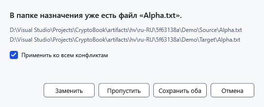

# Конфликты имён

Конфликт появляется, когда копирование или перемещение занимает уже существующее имя назначения. Перед выбором прочитайте пути источника и назначения: одинаковые имена не означают одинаковое содержимое.

1. Проверьте оба пути в окне **Конфликт имён**.
2. Выберите действие для объекта:

| Решение | Результат |
| --- | --- |
| **Заменить** | Подготавливает новую локальную копию и сохраняет прежнее назначение до завершения пакета. При отмене или ошибке прежнее назначение возвращается. Папка заменяется целиком, а не объединяется. |
| **Пропустить** | Оставляет существующее назначение и не передаёт этот источник. |
| **Сохранить оба** | Сохраняет существующий объект и передаёт источник под свободным именем. Проверьте фактическое новое имя. |
| **Отмена** | Останавливает планирование пакета. Пока собираются решения этих конфликтов, передачи из данного пакета ещё не начались. |

**Применить ко всем конфликтам** повторяет выбранное решение для остальных конфликтов пакета. Не ставьте флажок, если следующим объектам нужны другие решения. Закрытие окна конфликта означает отмену.

## После выбора

Дождитесь завершения операции, обновите список и сравните назначение с источником. Пропуск при перемещении оставляет соответствующий источник на месте. Копирование объекта в его же папку выбирает свободное имя копии; перенос в уже занимаемое им место пропускается.

Отмена в окне прогресса возвращает уже выполненные действия локального пакета. Прежнее назначение хранится до завершения передачи. Если возврату мешает блокировка или занятое имя, сохранённые данные можно вернуть командой **Восстановить операции** в папке с журналом из сообщения. После аварийного завершения откройте папку назначения и выполните эту команду.

## Связанные темы

- [Копирование и перемещение](help:files.transfer)
- [Ошибки записи](help:recovery.write)
