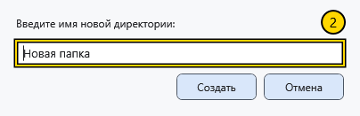

# Создать файл или папку

Создавайте объекты в доступной для записи папке и заранее проверьте адрес. У диалога создания файла своя папка назначения: её нужно проверить отдельно.

## Создать папку

1. Перейдите в родительскую папку и выберите **Создать папку** на панели или в меню фона.
2. Введите одно имя папки и подтвердите создание. **Отмена** закрывает диалог без создания.

Пустое имя, разделители пути и недопустимые символы отклоняются. Если папка с таким именем уже есть, появляется ошибка; существующая папка не заменяется. Исправьте имя и повторите попытку. Убедитесь, что новая папка появилась в нужном родителе.

## Создать файл

Выберите **Создать файл**. В диалоге документа проверьте папку назначения, тип, имя и шаблон, затем подтвердите. Созданный документ открывается в редакторе; для текущего несохранённого документа может потребоваться решение. Форматы, параметры страницы и атрибуты описаны в статье о создании документа.

Недопустимое или зарезервированное имя, разделитель пути, точка или пробел в конце отклоняются с сообщением; другой файл вместо запрошенного не создаётся. Исправьте имя в открытом диалоге и повторите создание. При занятом допустимом имени может выбираться стандартное свободное имя: после создания проверьте фактические имя и путь.

## Диалоги выбора

Этот же менеджер может открыться для выбора файла или папки. Нижняя кнопка подтверждает выбор, **Отмена** возвращает без выбора. Выбор папки подтверждает указанный каталог; **Открыть** обычного менеджера открывает объект. Перед продолжением проверьте заголовок окна, путь и кнопку подтверждения.

## Связанные темы

- [Создать и сохранить документ](help:doc.create)
- [Конфликты имён](help:files.conflicts)
