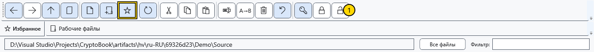

# Избранные папки

Избранное хранит ссылки на папки файлового менеджера. Оно не копирует папку, не закрепляет документ и не задаёт рабочую директорию поиска.

## Добавить и открыть

1. Перейдите в нужную папку и нажмите звезду на панели. Ссылка появится в полосе избранного.

Нажмите ссылку для перехода и проверьте адрес. Повторное добавление той же папки не создаёт ещё одну физическую папку. Назначение определяет путь, а не отображаемое имя ссылки.

## Переименовать или убрать ссылку

Нажмите избранную папку правой кнопкой и выберите **Переименовать**. Введите отображаемое имя и сохраните; **Отмена** отказывается от изменения. Меняется только подпись избранного, а не имя настоящей папки и не её путь. Команда **Удалить из избранного** из контекстного меню убирает ссылку: папка и содержимое остаются на диске.

## Если папка недоступна

Недоступную ссылку открыть нельзя. Восстановите доступ к диску или папке, затем заново откройте менеджер для обновления доступности. Изменение подписи не исправляет перемещённую папку. Перейдите к правильной папке, уберите старую ссылку и добавьте текущую. Для регулярно редактируемых файлов используйте закреплённые документы.

## Связанные темы

- [Навигация по папкам](help:files.navigate)
- [Закреплённые документы](help:files.pinned)
