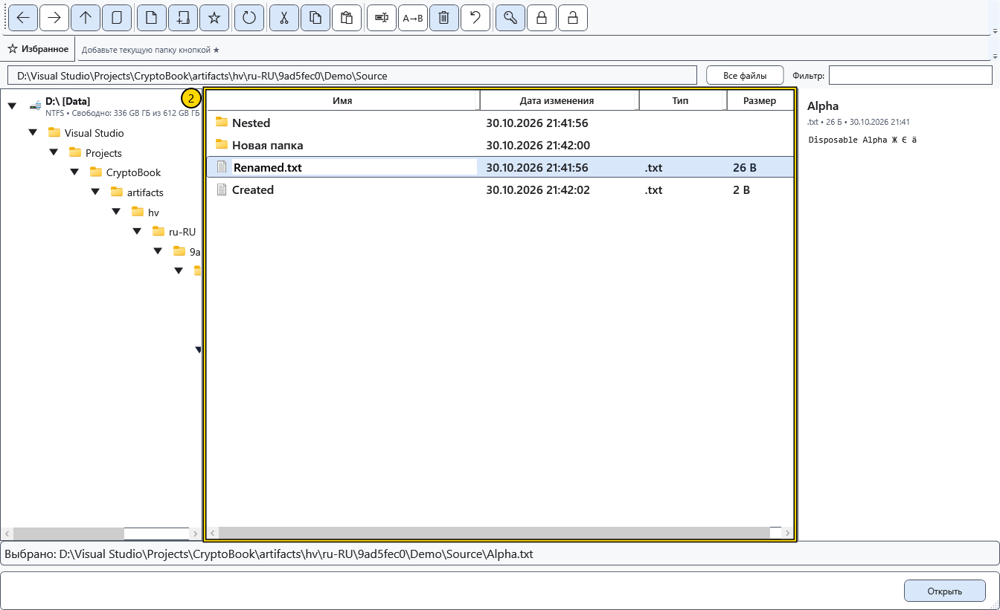

# Открытие, переименование и удаление

Команда использует выбранную строку. Перед изменением важных файлов сохраните отдельную копию. Локальное удаление запрашивает подтверждение и перемещает файлы и папки в корзину Windows.

## Открыть или скопировать путь

Двойной щелчок по папке открывает её. Для файла выберите **Открыть**: поддерживаемые документы открываются в CryptoBook, другие предусмотренные действия могут использовать внешнее приложение. **Открыть с помощью** вызывает системный выбор программы для одного локального файла. **Показать в Проводнике** показывает локальный объект в Проводнике Windows. Этим действиям нужны подходящий локальный объект и поддержка Windows.

**Копировать путь** помещает пути выделенных объектов отдельными строками в буфер Windows, но не копирует содержимое файлов. Перед использованием текста проверьте выделение и локальный адрес либо адрес устройства.

## Переименовать один объект

1. Выделите ровно один файл или папку и выберите **Переименовать**.
2. Измените имя в строке. Если новое расширение не указано, прежнее сохраняется автоматически. Явно введённое расширение заменяет прежнее. Чтобы убрать расширение намеренно, используйте групповое переименование с пустой маской расширения.

3. Нажмите Enter для применения. Esc запрашивает подтверждение отказа от редактирования; подтвердите отмену для возврата прежнего имени. При ошибке прежнее имя возвращается и появляется сообщение.

После успеха обновите список и проверьте полный путь. Одиночное переименование обновляет совпадающий путь активного документа, закреплённых и недавних ссылок; сбой записи ссылок может сообщаться отдельно. Дерево папок и внешние ярлыки не являются универсальным отслеживанием документов. Для двух и более локальных файлов есть отдельное групповое переименование.

## Удалить

Выделите локальные объекты, выберите **Удалить** и подтвердите выбор. **Отмена** в подтверждении оставляет файлы на месте. Объекты перемещаются в корзину Windows под исходными именами; рядом с ними не создаются папки хранения удалённых файлов. Если перемещение в корзину недоступно, появляется ошибка; безвозвратное удаление вместо корзины не выполняется.

Для возврата откройте **Корзину** Windows, выделите нужные объекты и выберите **Восстановить**. Они вернутся в исходные папки. Если отменить уже начавшееся удаление нескольких объектов или возникнет ошибка, часть объектов может находиться в корзине, остальные остаются на месте. Уже помещённые в корзину возвращаются её средствами. После очистки корзины или окончательного удаления из неё обычное восстановление недоступно.

Для Android и других удалённых источников действует отдельное предупреждение о безвозвратном удалении. В смешанном выделении локальные объекты идут в корзину, а удалённые обрабатываются по правилам устройства.

## Восстановить прерванные операции

Кнопка **Восстановить операции** на панели доступна только при наличии незавершённого журнала в открытой папке. Она недоступна во время восстановления и отключается после успешного завершения. Наличие журнала проверяется при переходе в папку, обновлении списка и завершении файловой операции. Для прерванной передачи откройте папку назначения; для группового переименования — папку первого исходного файла. Файлы из корзины Windows этой кнопкой не возвращаются.

Если прежняя сборка сохранила удалённые объекты в соседней папке восстановления, их по-прежнему можно вернуть этой кнопкой из папки с прежним журналом.

## Связанные темы

- [Групповое переименование](help:files.batch)
- [Возможности и ограничения источников](help:devices.limits)
- [Два редактора, переименование и закрытие](help:doc.switch)
