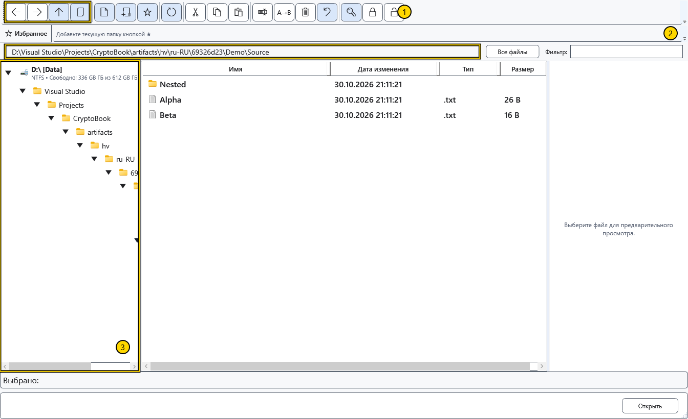
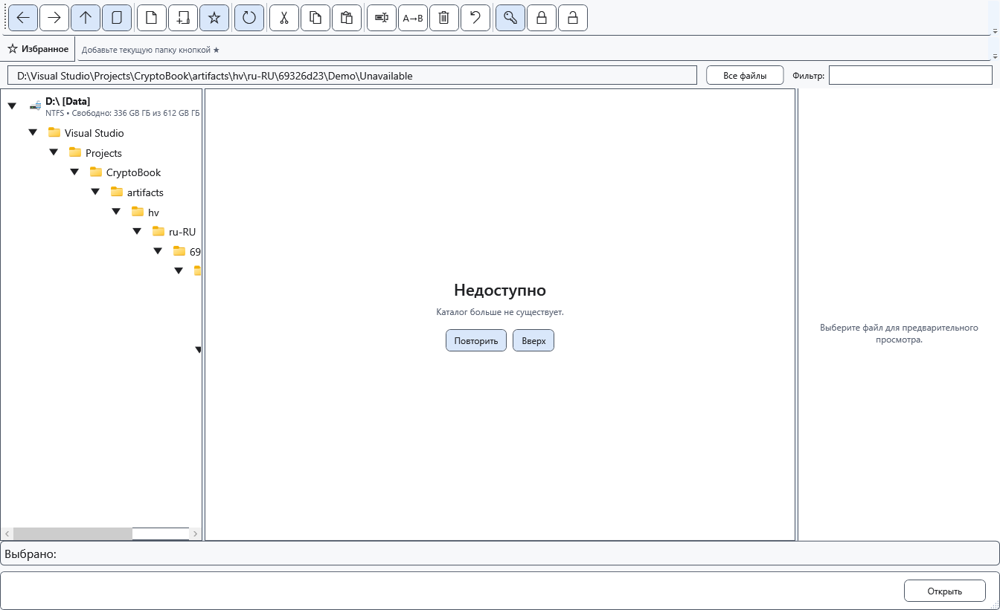

# Навигация по папкам

У файлового менеджера своя текущая папка и история переходов. Просмотр папок не меняет рабочую директорию поиска и документ, уже открытый в редакторе.

## Выбрать папку

1. Откройте файловый менеджер из меню документов. Выберите диск и папку в дереве слева; раскрывайте ветку стрелкой. Двойной щелчок по папке в списке открывает её.
2. Можно ввести полный локальный путь папки в адресной строке и нажать Enter. Esc возвращает текущий адрес без перехода.
3. Стрелки панели ведут назад, вперёд и в родительскую папку. **Показать текущий документ** переходит к папке документа с сохранённым путём. **Обновить** перечитывает текущую папку.

На снимке: 1 — кнопки переходов, 2 — адрес, 3 — дерево папок. Проверяйте адрес перед созданием, вставкой и удалением. Выбранная папка дерева и выделенные файлы списка используются разными командами.

## Если папка недоступна

Вместо списка может появиться панель недоступной папки. Проверьте путь, подключение диска и права, восстановите доступ и нажмите кнопку повторной попытки. Можно также подняться в доступную родительскую папку. Пустой или недоступный список не доказывает удаление файлов.

Закройте менеджер для возврата к документу. Закрытие не отменяет завершённые файловые операции. Адреса и возможности устройств отличаются от локальных путей; адрес устройства нельзя считать обычным путём Windows.

## Связанные темы

- [Выбрать рабочую директорию](help:start.workspace)
- [Устройства Android](help:devices.android)
- [Сортировка, фильтр и выделение](help:files.views)
