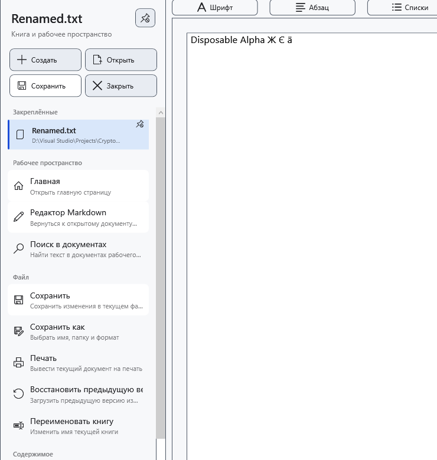

# Закреплённые документы

Закрепите документ, чтобы сохранить ссылку на его файл в боковом меню. Закрепление не сохраняет правки и не создаёт резервную копию. Документу нужен пригодный сохранённый путь.

1. Откройте документ и разверните боковое меню. В быстрых действиях выберите **Закрепить текущий документ**. Файл появится в разделе **Закреплённые**; та же кнопка станет **Открепить текущий документ**.

Нажмите закреплённый файл для открытия. Текущий документ и несохранённое состояние отмечаются отдельно от доступности. При открытии другого документа может появиться запрос о несохранённых правках; отказ от переключения сохраняет текущий документ.

## Управлять списком

Нажмите запись правой кнопкой. **Переместить выше** и **Переместить ниже** меняют только порядок ссылок. **Показать в Проводнике** показывает локальный файл в Windows. Открытие контекстного меню обновляет доступность. **Открепить** удаляет только ссылку, оставляя файл на месте.

## Найти перемещённый файл

Если файла нет, сначала подключите его диск. Для действительно перемещённого файла выберите **Указать новое расположение…** и укажите существующее новое расположение; отмена выбора сохраняет прежнюю ссылку. Это исправление ссылки без переноса файла. Проверьте имя и содержимое, чтобы не привязать посторонний файл.

Одиночное и групповое переименование в менеджере обновляет совпадающие пути текущего, закреплённых и недавних документов. При предупреждении записи ссылок проверьте фактический путь на диске и исправьте ссылку. Произвольное внешнее перемещение не следует считать автоматически отслеживаемым.

## Связанные темы

- [Последние документы](help:files.recent)
- [Два редактора, переименование и закрытие](help:doc.switch)
