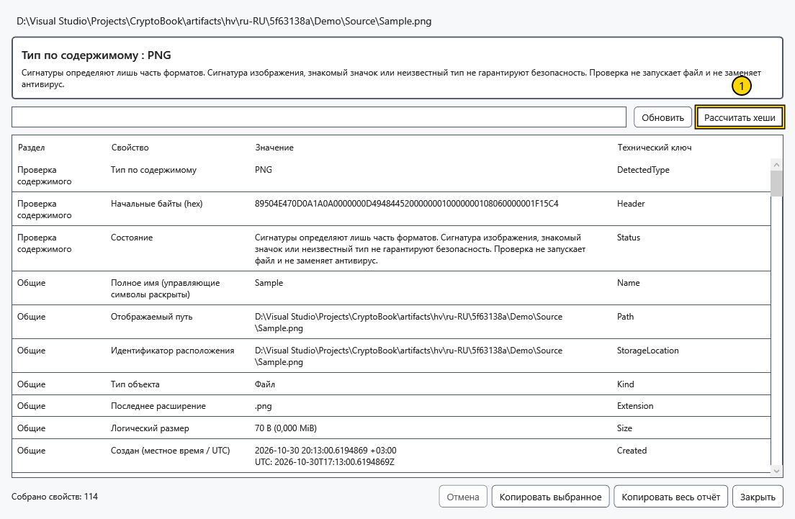
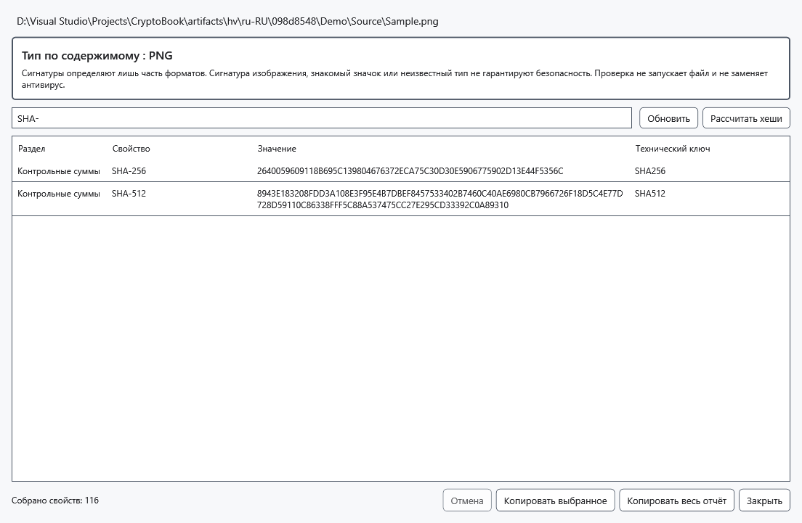

# Подробные свойства и хеши

Подробный отчёт исследует выбранный объект без его исполнения. Он помогает сравнить файлы и заметить расхождение имени с содержимым. Распознанный формат или действительная подпись не гарантируют безвредность содержимого.

1. Выделите один файл и выберите **Подробные свойства** в контекстном меню либо нажмите Alt+Enter с фокусом в списке файлов. Для папки есть команда контекстного меню. **Свойства** — отдельное действие свойств Windows.
2. Дождитесь окончания чтения. Обнаруженный тип определяется по поддерживаемым заголовкам файла, а не только расширению. Неизвестные форматы и ошибки разделов показываются без потери остальных доступных сведений.

Отмеченная кнопка запускает расчёт хешей. Для локального файла отчёт может включать размер, местные/UTC-даты, атрибуты, цель ссылки, занятое место, идентификаторы тома/файла, жёсткие ссылки, владельца и сохранённые правила доступа. Правила не являются вычислением ваших эффективных разрешений. Потоки NTFS и ограниченный текст Zone.Identifier, значения Windows Property System, медиа/EXIF и свойства документов зависят от файловой системы, обработчиков и прав.

Для поддерживаемых исполняемых файлов читаются версия, сведения PE/CLR и подписи без загрузки файла как программы. Подписи проверяются по локально доступным сведениям без сетевого обновления отзыва; данные сертификата и результат доверия разделены. Обнаружение ZIP/OLE означает контейнер, а не безопасность его содержимого. Зашифрованный .cbook рассматривается как контейнер без автоматической расшифровки.

Названия от обработчиков свойств Windows могут соответствовать языку Windows; технические ключи и сохранённые значения показаны как получены.

## Хеши и копирование

3. Нажмите **Рассчитать хеши** для SHA-256 и SHA-512 за один проход. Сравнивайте значения целиком с доверенным эталоном именно этого файла. **Отмена** останавливает работу кооперативно; уже выполняющийся нативный вызов Windows может завершиться позже. Записываемый или изменившийся во время чтения файл может дать ошибку; закройте записывающую программу и повторите.

Введите часть раздела, названия, значения или технического ключа в поле поиска. Очистите его для всех строк. Выделите строки с Ctrl/Shift и нажмите **Копировать выбранное** либо **Копировать весь отчёт** для всех собранных свойств даже при фильтре. **Обновить** перечитывает свойства; после этого рассчитайте хеши снова. Закройте окно для возврата без изменения исследуемого файла.

Удалённые источники дают только доступные метаданные объекта. Полная проверка содержимого, Windows/NTFS-сведения, подписи и хеши требуют локальной копии. Отсутствие полей может отражать ограничения формата, обработчика или доступа; отчёт не является антивирусом и универсальным перечнем всех внутренних полей любого формата.

## Связанные темы

- [Возможности и ограничения источников](help:devices.limits)
- [Совместимость защищённых файлов](help:security.compatibility)
