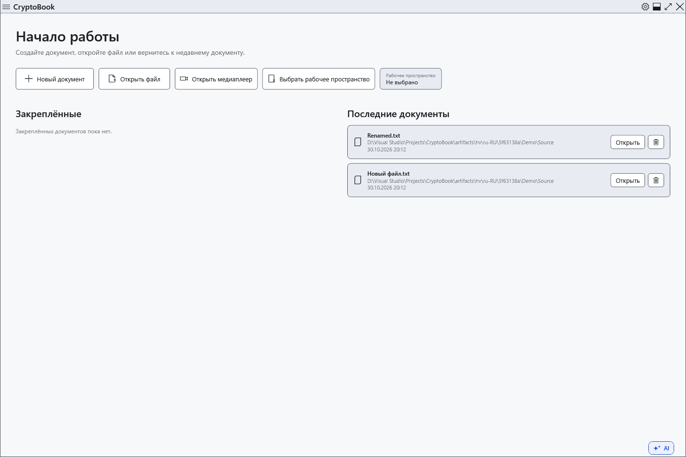

# Последние документы

Начальный экран показывает документы после успешного открытия или сохранения. Это история ссылок на файлы, а не сохранённые копии и не архив содержимого документов.

1. Закройте текущий документ, приняв решение о несохранённых правках, чтобы вернуться к начальному экрану. Найдите раздел **Последние документы**.

Нажмите недавний документ для открытия его текущего файла. Проверьте имя и родительскую папку, особенно при одинаковых именах. Запись истории не гарантирует, что диск подключён и исходный файл существует.

## Недоступные и перемещённые файлы

Сначала подключите диск. Для перемещённого файла выберите **Найти…** и укажите существующее новое расположение. Отмена выбора сохраняет прежнюю ссылку. Новый путь обновляет ссылку, но не восстанавливает удалённое содержимое и не переносит файл. Закреплённые и недавние — разные списки, поэтому при ручном исправлении проверьте оба.

**Удалить из истории** убирает ненужную запись. Физический файл остаётся; успешное открытие или сохранение может снова добавить его в историю. Удаление записи не является удалением документа. Для списка быстрого доступа, который вы поддерживаете сами, закрепите документ в боковом меню.

Если историю не удалось обновить, открытый файл и сохранённая ссылка — отдельные результаты. Проверяйте фактический путь и сообщение операции: старая запись сама по себе не доказывает ошибку сохранения файла.

## Связанные темы

- [Закреплённые документы](help:files.pinned)
- [Открыть документ](help:doc.open)
