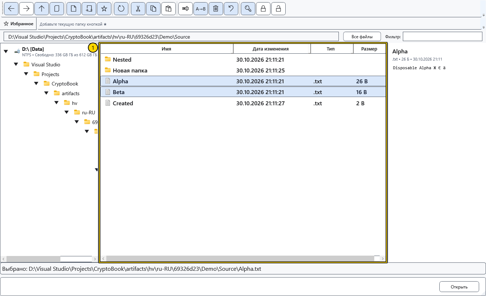
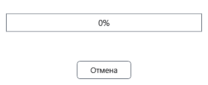

# Копирование и перемещение

Эти шаги относятся к локальным файлам и папкам. Перед переносом важных данных сохраните отдельную копию и проверьте источник и назначение. При отмене или ошибке CryptoBook возвращает изменения локального пакета по журналу.

1. Выделите исходные строки с Ctrl или Shift. Выберите **Копировать** для сохранения исходников или **Вырезать** для переноса. Команды запоминают файловую операцию внутри CryptoBook; **Копировать путь** отдельно копирует текст в буфер Windows.

2. Перейдите в папку назначения и выберите **Вставить**. Другой путь — **Переместить** для исходного выделения и выбор назначения в диалоге папки; отмена выбора оставляет файлы на месте. Разрешите конфликты имён до начала передачи.
3. Дождитесь завершения окна прогресса. **Отмена** или закрытие окна запрашивает отмену; окно остаётся до остановки работы и обновления списка.

Можно перетащить выделение на папку назначения в дереве или списке. Удержание Ctrl запрашивает копирование, без Ctrl — перемещение. Проверьте цель перед отпусканием. Папку нельзя переместить в себя или потомка; корень диска не является обычным переносимым объектом.

## Проверить результат

Обновите назначение и откройте пример скопированного файла. После перемещения проверьте и назначение, и источник. Успешная вставка после вырезания очищает запомненный перенос. Не считайте, что перемещение обновляет все сохранённые ссылки на документ: у одиночного и группового переименования есть собственное обновление путей.

## Отмена и ошибки

Отмена или ошибка запускает возврат всего локального пакета, включая уже переданные элементы и прежние объекты назначения. При переносе между томами копия проверяется перед удалением сохранённого источника. Если занятое имя или внешняя блокировка мешает возврату, данные и журнал сохраняются; сообщение укажет папку журнала. После устранения помех откройте эту папку и нажмите **Восстановить файлы**. После аварийного завершения используйте ту же команду в папке назначения. Успешно завершённая передача отдельного отката не хранит. Передачи с устройствами имеют собственные правила.

## Связанные темы

- [Конфликты имён](help:files.conflicts)
- [Передача на устройства](help:devices.transfers)
