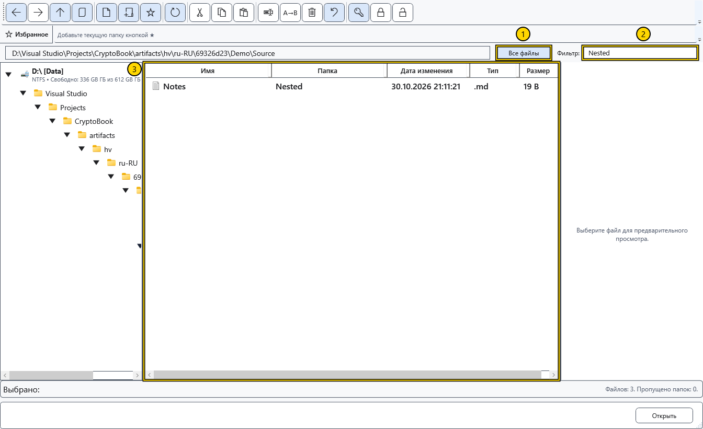

# Сортировка, фильтр и выделение

Настройте список перед выбором файлов для операции. Фильтр меняет видимость строк, но ничего не перемещает и не удаляет.

## Настроить представление

Нажмите заголовок столбца для сортировки; повторное нажатие меняет направление. Доступны имя, дата изменения, тип и размер. Граница заголовка меняет ширину столбца. Вертикальные разделители меняют ширину дерева, списка и области просмотра.

Включите **Все файлы**, чтобы получить файлы текущей папки и всех вложенных папок. Дополнительный столбец папки показывает относительное расположение; сами папки строками этого режима не становятся. При выборе папки в диалоге режим недоступен.

На снимке: 1 — рекурсивный режим, 2 — фильтр, 3 — список. Введите текст в **Фильтр:**: он сопоставляется с именем, включая расширение, а в рекурсивном режиме — ещё и с относительной папкой. Очистите поле для возврата списка. Это фильтр по подстроке, а не поиск в содержимом документов.

## Чтение и выделение

Строка состояния показывает чтение, количество файлов и пропущенных папок. Кнопка отмены чтения останавливает обход большого дерева; список после этого может быть неполным. Обновите его для новой попытки или выключите **Все файлы** для возврата в текущую папку. Пропущенные и недоступные папки не означают пустой источник.

Щелчок выделяет один объект, Ctrl со щелчком — отдельные строки, Shift со щелчком — диапазон. Перед командой проверьте подсвеченные строки: контексты дерева, фона и строки имеют разные цели. Счётчик группового переименования следует видимому порядку файлов, а не порядку щелчков.

## Связанные темы

- [Навигация по папкам](help:files.navigate)
- [Групповое переименование](help:files.batch)
- [Поиск файлов по имени](help:search.name)
