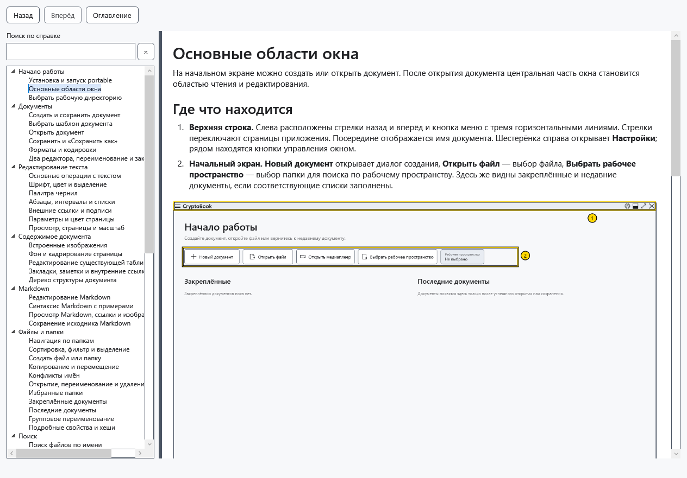
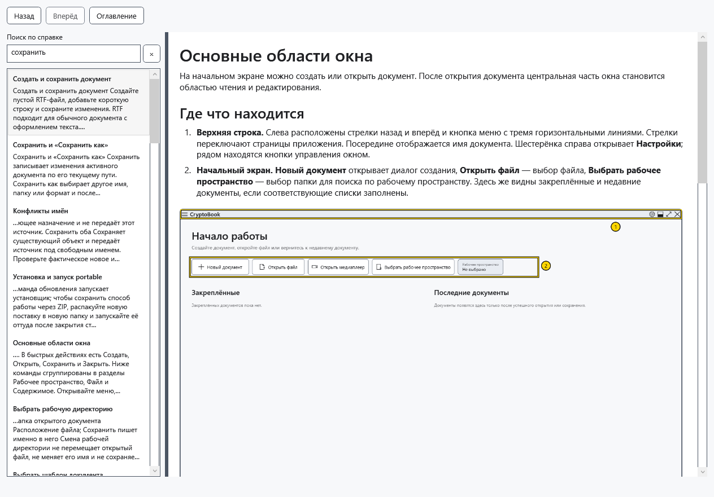
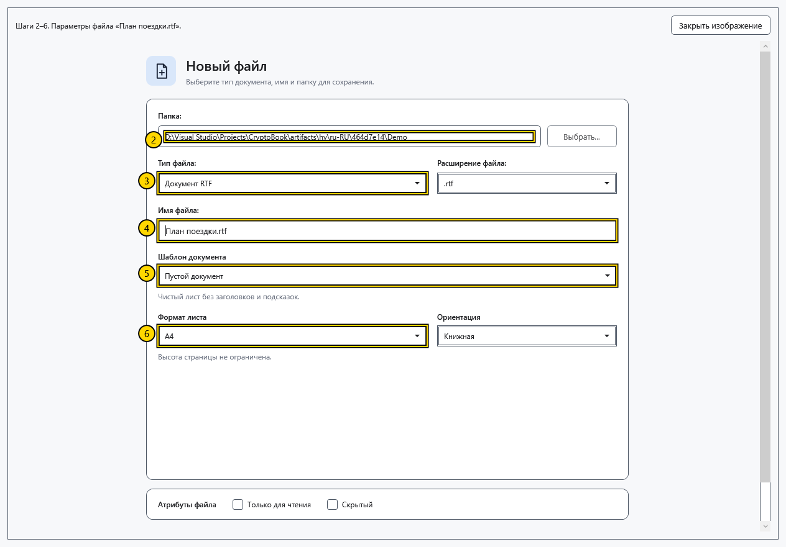

# Оглавление, поиск и иллюстрации справки

Встроенная справка доступна без сети и не требует открытого документа. Она открывается отдельным немодальным окном: можно вернуться к работе, не закрывая статью.

## Открыть тему

1. В боковом меню главного окна выберите **Справка** либо нажмите **F1** в главном окне. Повторный вызов активирует уже открытое окно, в том числе свёрнутое.
2. Слева раскройте раздел и выберите статью. Разделитель между оглавлением и текстом меняет ширину областей; статью можно прокручивать.

## Найти и вернуться

3. Введите слова в **Поиск по справке** или нажмите Ctrl+F. Поиск учитывает заголовки, ключевые слова и текст статей текущего языка, требует наличия всех слов и не ищет ваши документы.
4. Щёлкните результат либо выберите его и нажмите Enter. Если результатов нет, сократите запрос или попробуйте другое слово.

5. Кнопки **Оглавление** и **×** очищают запрос и возвращают дерево; они не переключают статью на первую. **Назад / Вперёд** или Alt+←/→ перемещают по истории прочитанных тем и восстанавливают положение чтения. Новая ветвь переходов заменяет прежнюю историю вперёд.

## Увеличить изображение

6. Щёлкните иллюстрацию либо перейдите к её кнопке клавишей Tab и нажмите Enter. Большой снимок можно прокручивать.

7. Нажмите **Закрыть изображение** либо Esc. В поле поиска Esc сначала очищает запрос, а при пустом запросе переводит фокус в статью. Для закрытия окна используйте его крестик или Alt+F4.

Последняя тема и размеры окна сохраняются; история переходов существует только до закрытия окна. После смены языка открывается перевод той же темы, запрос очищается и прокрутка начинается заново. Справка Markdown из редактора ведёт к теме синтаксиса в этом же окне. Если изображение недоступно, используйте текст шагов и сообщите версию программы; для штатной работы отдельная загрузка изображений не нужна.

- [Основные области окна](help:start.interface)
- [Язык приложения](help:settings.language)
- [Редактор Markdown](help:md.edit)
- [Горячие клавиши](help:settings.hotkeys)
