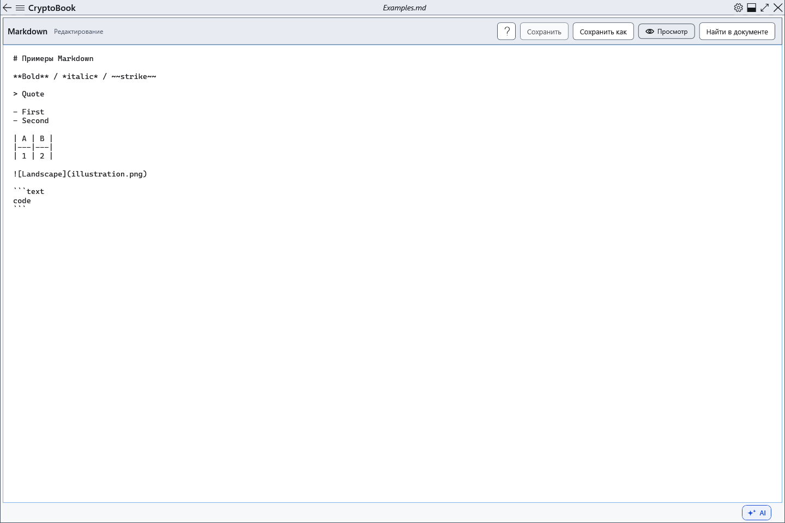

# Редактирование Markdown

Markdown — отдельный текстовый документ с разметкой. Он может быть открыт одновременно с обычным документом; файловые команды относятся к выбранному редактору.

## Порядок действий

1. Откройте файл .md или создайте Markdown-документ. Введите разметку в поле исходного текста; Tab вставляет табуляцию, Ctrl+Z отменяет ввод в этом поле.
2. Нажмите **Просмотр**, чтобы увидеть результат. Кнопка **Редактор** возвращает к исходнику. Чтобы изменить результат, исправляйте исходную разметку.
3. Кнопка справки открывает статью о синтаксисе в отдельном немодальном окне. Основной редактор и оба документа остаются на месте. Закройте справку через её кнопку закрытия или Alt+F4 при фокусе в ней.

## Проверка, отмена и ограничения

Сохраните через **Сохранить** или Ctrl+S; Ctrl+Shift+S выбирает другой файл. Проверьте исходник после повторного открытия. Просмотр создаётся заново из текущего текста и не преобразуется обратно в Markdown. Не пытайтесь форматировать его панелью обычного редактора. Переключение страницы не означает сохранение; перед закрытием учитывайте несохранённые изменения.

## Связанные темы

- [Синтаксис Markdown с примерами](help:md.syntax)
- [Сохранение исходника Markdown](help:md.save)
- [Два редактора, переименование и закрытие](help:doc.switch)
