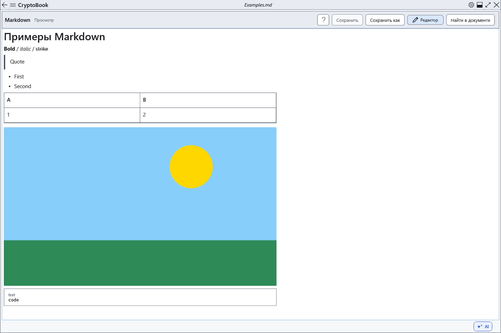

# Просмотр Markdown, ссылки и изображения

Просмотр показывает оформленную копию текущего Markdown. Изменять следует исходник, а не результат просмотра.

## Порядок действий

1. Нажмите **Просмотр**. Заголовки, списки, код и таблицы строятся из текста; чтобы обновить результат после правки, снова откройте просмотр.
2. Веб-ссылки HTTP/HTTPS и почтовые mailto могут открываться через системные приложения. Относительные ссылки на документы, file: и ftp: не активируются.
3. Для изображения сохраните файл рядом с .md или в его подпапке и напишите ``. Разрешены только локальные относительные пути, файл до 25 МиБ; декодирование ограничивается 1600 пикселями. Сетевые и абсолютные пути изображений не загружаются.

## Проверка, отмена и ограничения

HTML остаётся неактивным текстом. Если вместо изображения видна подпись, проверьте путь относительно файла Markdown, наличие и размер изображения; перенесите оба файла вместе. Возврат через **Редактор** сохраняет исходник. Не рассчитывайте на оформление расширений, для которых нет примера поддерживаемого результата: задачи, сноски и формулы не становятся полноценными интерактивными элементами или вычислениями.

## Связанные темы

- [Синтаксис Markdown с примерами](help:md.syntax)
- [Поиск в документе](help:search.document)
