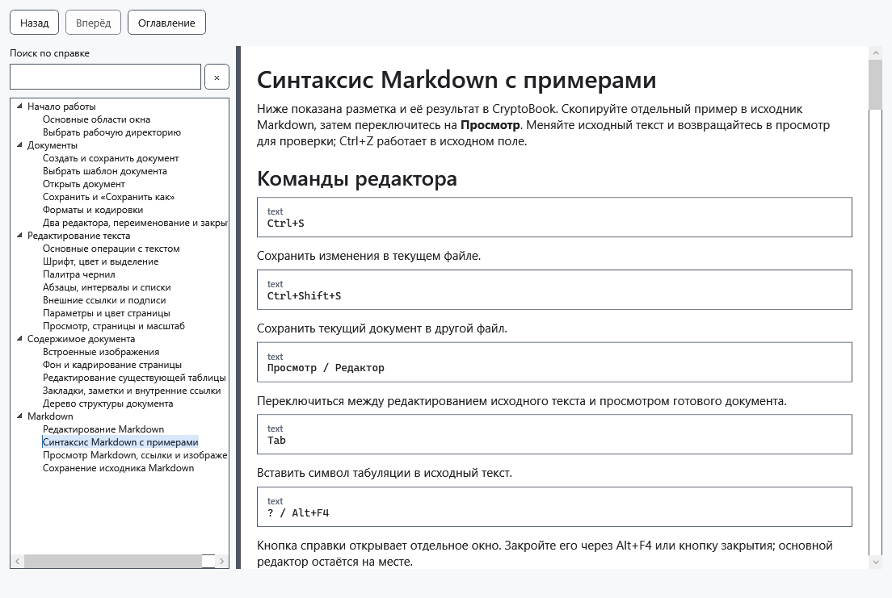

# Синтаксис Markdown с примерами

Ниже показана разметка и её результат в CryptoBook. Скопируйте отдельный пример в исходник Markdown, затем переключитесь на **Просмотр**. Меняйте исходный текст и возвращайтесь в просмотр для проверки; Ctrl+Z работает в исходном поле.

## Команды редактора

````text
Ctrl+S
````

Сохранить изменения в текущем файле.

````text
Ctrl+Shift+S
````

Сохранить текущий документ в другой файл.

````text
Просмотр / Редактор
````

Переключиться между редактированием исходного текста и просмотром готового документа.

````text
Tab
````

Вставить символ табуляции в исходный текст.

````text
? / Alt+F4
````

Кнопка справки открывает отдельное окно. Закройте его через Alt+F4 или кнопку закрытия; основной редактор остаётся на месте.

## Заголовки и разделители

````text
# H1
## H2
…
###### H6
````

ATX-заголовки уровней 1–6. В конце можно добавить такое же количество символов #.

````text
Heading 1
=========
````

Setext-заголовок первого уровня.

````text
Heading 2
---------
````

Setext-заголовок второго уровня.

````text
---
***
___
````

Горизонтальный разделитель из трёх или более символов -, * или _.

## Списки и цитаты

````text
> quote
>> nested
````

Блок цитаты. Дополнительные символы > создают вложенные цитаты.

````text
- item
+ item
* item
````

Маркированный список; маркером может быть -, + или *.

````text
1. item
2) item
````

Нумерованный список с . или ) после числа. Первое число задаёт начало нумерации.

````text
- parent
    - child
````

Отступ создаёт вложенный список. В пункты можно вкладывать абзацы, цитаты, код и другие списки.

## Форматирование внутри строки

````text
*italic*
_italic_
````

Курсивный текст.

````text
**bold**
__bold__
````

Полужирный текст.

````text
***bold italic***
````

Полужирный курсив. Вместо трёх звёздочек можно использовать три подчёркивания.

````text
~~strike~~
````

Зачёркнутый текст.

````text
`code`
``code with ` inside``
````

Фрагмент кода моноширинным шрифтом. Если внутри есть обратная кавычка, используйте более длинный ограничитель.

````text
\*literal asterisks\*
````

Обратная косая черта показывает служебный символ буквально, не применяя разметку.

````text
&copy;
&#169;
````

Именованная или числовая HTML-сущность, преобразуемая в символ Unicode.

## Абзацы и переносы строк

````text
text

text
````

Пустая строка начинает новый абзац.

````text
text
text
````

Обычный перевод строки в исходном тексте отображается как пробел внутри того же абзаца.

````text
text  ⏎
text
````

Два пробела в конце строки вставляют перенос без создания нового абзаца.

````text
text\
text
````

Обратная косая черта в конце строки также вставляет принудительный перенос.

## Ссылки и изображения

````text
[text](https://example.com)
````

Активная HTTP-, HTTPS- или почтовая ссылка.

````text
[text][ref]

[ref]: https://example.com
````

Ссылка, URL которой объявлен отдельно. Также поддерживаются сокращённые формы [text][] и [ref].

````text
<https://example.com>
````

Веб-адрес без отдельной подписи, отображаемый как активная ссылка.

````text
<name@example.com>
````

Адрес электронной почты, преобразуемый в активную ссылку mailto.

````text
https://example.com
````

Обычный HTTP- или HTTPS-адрес распознаётся автоматически.

````text

````

Изображение рядом с Markdown-файлом или в относительной вложенной папке.

````text
![alt][image]

[image]: images/picture.png
````

Локальное изображение, относительный путь к которому объявлен в определении ссылки.

## Блоки кода

````text
```csharp
code
```
````

Ограждённый блок кода. Текст после открывающей ограды показывается как имя языка; подсветки синтаксиса нет.

````text
~~~text
code
~~~
````

Ограждённый блок кода из трёх или более тильд вместо обратных кавычек.

````text
    indented code
````

Блок кода, созданный отступом каждой строки на четыре пробела или одну табуляцию.

## Таблицы

````text
| A | B |
|---|---|
| 1 | 2 |
````

Таблица с вертикальными чертами. Строка-разделитель создаёт заголовок; крайние черты необязательны.

````text
+---+---+
| A | B |
+===+===+
| 1 | 2 |
+---+---+
````

Сеточная таблица. Символ = отмечает границу заголовка; поддерживается объединение строк и столбцов.

## Ограничения предпросмотра

````text
<b>HTML</b>
````

HTML-код показывается как неактивный исходный текст и никогда не исполняется.

````text
[file](file:///…)
[ftp](ftp://…)
[relative](relative.md)
````

FTP, file, относительные, javascript- и прочие ссылки вне HTTP отображаются как текст, а не как активные ссылки.

````text

````

Удалённые изображения и изображения по абсолютному пути не загружаются; вместо них показывается альтернативный текст.

````text
- [x] task
[^1] footnote
$math$
````

Вся специально отображаемая разметка перечислена выше. Остальные расширения Markdig — флажки задач, сноски, формулы, диаграммы, списки определений, предупреждения, контейнеры, медиавставки, сокращения, вставленный и выделенный текст, нижние и верхние индексы — не имеют соответствующего оформления.




## Проверка, отмена и ограничения

В примерах H1…H6 обозначают уровни заголовков: вместо строки с многоточием введите нужное количество #. Текст code — содержимое блока, а не запускаемая команда. Пробелы и пустые строки влияют на результат: для жёсткого переноса нужны два пробела в конце строки или обратная косая черта. Если пример не оформился, сравните знаки и отступы в исходнике. Просмотр не выполняет код и HTML. Сохраняйте .md, чтобы сохранить саму разметку.

В примере переноса ⏎ обозначает конец строки: не вводите сам знак, оставьте перед переводом строки два пробела.

## Связанные темы

- [Просмотр Markdown, ссылки и изображения](help:md.preview)
- [Редактирование существующей таблицы](help:content.tables)
