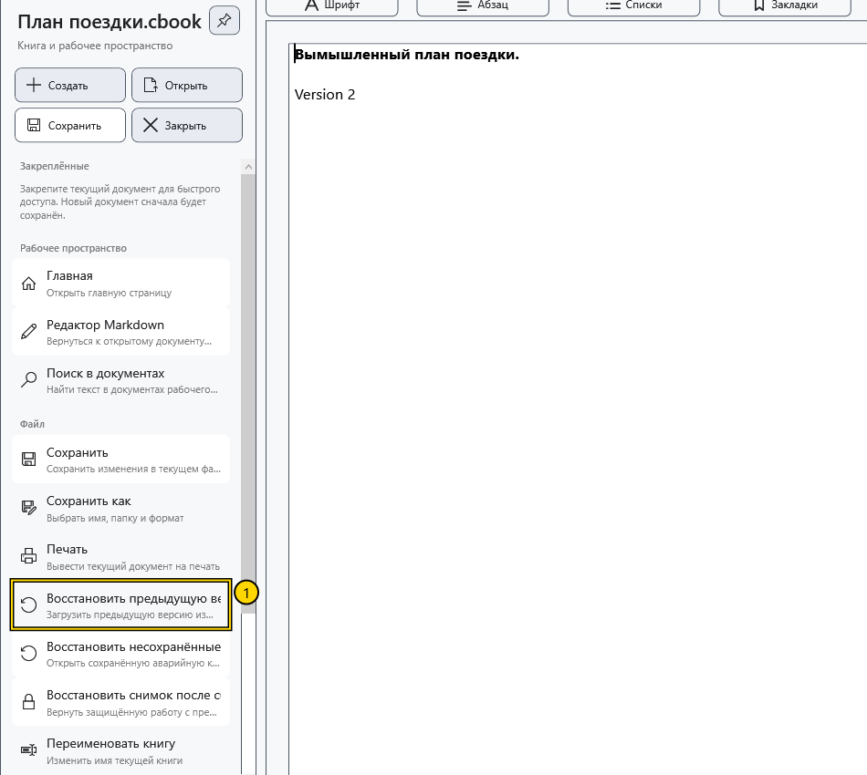
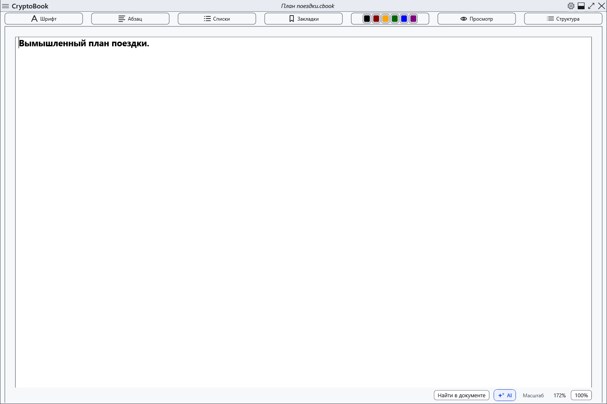

# Восстановить предыдущую версию .bak

При успешной замене уже существующего локального документа рядом сохраняется его прежняя версия с добавленным .bak. Это одна предыдущая версия, а не история всех изменений. Первое сохранение нового файла не обязано создавать .bak.

## Порядок действий

1. Откройте исходный документ. Перед восстановлением сохраните текущие нужные изменения отдельно: загрузка предыдущей версии заменяет содержимое редактора.
2. Откройте боковое меню → **Восстановить предыдущую версию**. Команда требует существующего файла .bak рядом с текущим документом.

3. Проверьте путь в подтверждении и согласитесь. Для защищённой копии нужен соответствующий ключ. При отказе текущий текст остаётся прежним.
4. Просмотрите восстановленный документ. Он помечен как изменённый: исходный файл на диске ещё не заменён. Сохраните его явно либо выберите **Сохранить как**, чтобы сохранить оба варианта.

## Ограничения и возврат

Следующее сохранение обновляет .bak. Обычная резервная копия может содержать открытый текст; .bak защищённого документа требует ключа. При смене ключа несовместимая .bak синхронизируется с текущим защищённым файлом, поэтому не гарантирует более ранний текст. Переименование документа через приложение переносит связанную .bak.

Если команда недоступна, проверьте, открыт ли нужный документ и есть ли рядом его .bak. Не путайте этот механизм с аварийным снимком или снимком блокировки. Чтобы отказаться после просмотра, закройте без сохранения восстановленных изменений и откройте исходный файл заново; нужный текущий текст заранее сохраните отдельно.

- [Сохранение](help:doc.save)
- [Аварийная копия](help:recovery.crash)
- [Снимок блокировки](help:recovery.lock)
