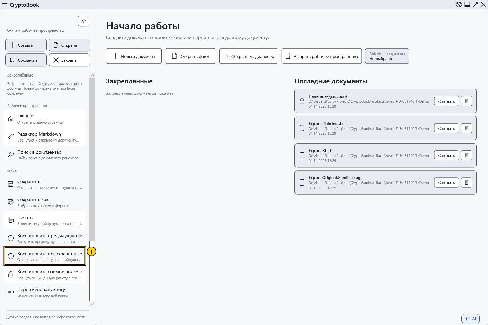
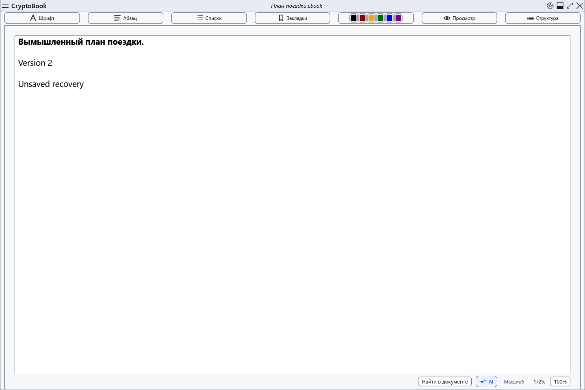

# Аварийный снимок несохранённых изменений

CryptoBook периодически сохраняет отдельный снимок изменённого рабочего пространства. Он помогает после неожиданного завершения, но не заменяет обычное сохранение: самые последние действия могли ещё не попасть в копию. Обычный интервал ожидания — около 15 секунд после изменений.

## Восстановить сохранённую копию

1. Сохранённые аварийные копии хранятся отдельно от новой работы. Приложение запускается без уведомлений о восстановлении.
2. Откройте боковое меню → **Файл** → **Восстановить несохранённые изменения**. Если копии нет, команда недоступна. При нескольких копиях возвращается последняя по времени сохранения; более старые остаются для следующего восстановления.
3. Если текущие документы изменены, сначала выберите сохранение, отказ от изменений или отмену. Для защищённого снимка введите ключ CryptoBook, использованный при его создании. Пароль Windows его не заменяет.

4. Проверьте восстановленное содержимое и сохраните его явно. Оно открывается как изменённое; при наличии двух документов проверьте оба. Перед удалением использованной отложенной копии приложение записывает новую аварийную копию восстановленной работы.

## Отмена и ошибки

Можно продолжать работу без открытия восстановления. Отмена ввода ключа или решения по текущему документу сохраняет копию. При неверном пароле или ошибке доступа проверьте исходный ключ и повторите попытку; не удаляйте файлы восстановления.

Старые аварийные копии могут использовать прежнюю защиту учётной записью Windows, в том числе для ранее защищённой работы. Новый пароль не меняет уже созданные копии; требование ключа CryptoBook относится к новому формату защищённых снимков.

Снимки находятся в данных пользователя, отдельно от .bak и Lock. Обычные снимки защищаются средствами текущей учётной записи Windows; защищённые документы — паролем CryptoBook. Перенос обычного снимка другому пользователю Windows не гарантирует чтение. При штатном закрытии текущий аварийный снимок удаляется; ранее отложенные копии сохраняются. Это не резервное копирование на другой носитель.

- [Снимок блокировки](help:recovery.lock)
- [Ошибки записи](help:recovery.write)
- [Два редактора](help:doc.switch)
