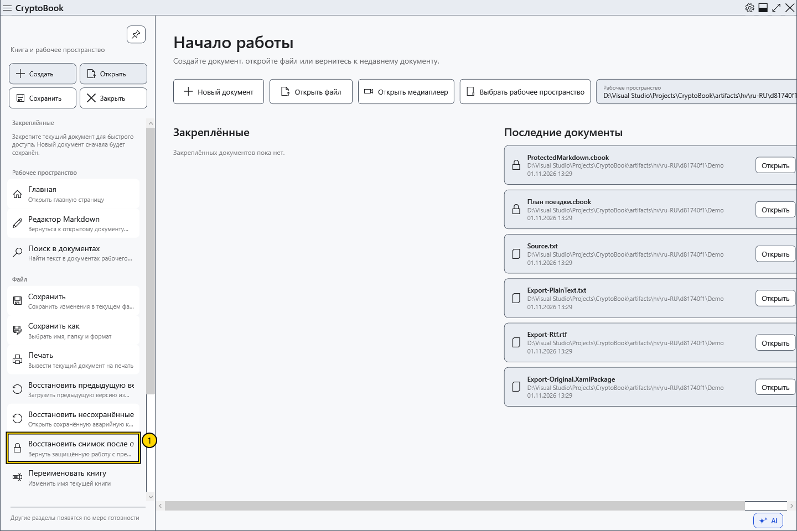
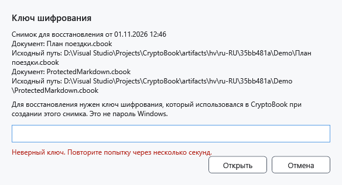
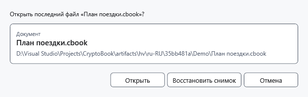

# Восстановить снимок после сброса ключа

Снимок блокировки создаётся при сбросе ключа для защищённой работы. Он хранится отдельно от .bak и аварийной копии, не перезаписывает исходный обычный файл и требует прежнего ключа CryptoBook.

## Порядок действий

1. Откройте боковое меню → **Файл** → **Восстановить снимок после сброса ключа**. Уведомления при запуске и после успешного сброса не появляются. Без снимка команда недоступна. При скрытой после ошибки работе используйте **Разблокировать** и не закрывайте приложение.

2. Проверьте описание документа и введите ключ, действовавший при создании снимка. Здесь одно скрытое поле, повтор не нужен. **Открыть** проверяет ключ до доступа к содержимому. Неверный ключ не удаляет снимок; перед повтором подождите несколько секунд.

3. После верного ключа выберите **Открыть**, чтобы открыть сохранённый исходный файл, либо **Восстановить снимок**, чтобы вернуть несохранённое содержимое снимка. Если исходник недоступен, остаётся вариант снимка. При двух защищённых документах проверьте оба; вариант открытия исходника берёт его сохранённую версию, а не последние изменения активного документа.

## Результат и отмена

После успешного восстановления снимок удаляется. Восстановленное из снимка содержимое помечено как изменённое и требует сохранения. Отмена ввода/выбора не удаляет снимок. Отмена выбора после проверки ключа оставляет ключ в памяти — при необходимости сбросьте его снова.

Если запись снимка ранее не удалась, восстановление скрытой памяти возможно только в ещё работающем процессе с прежним ключом. При забытом пароле универсального обхода нет.

- [Сброс ключа](help:security.lock)
- [Аварийная копия](help:recovery.crash)
- [Предыдущая версия](help:recovery.backup)
