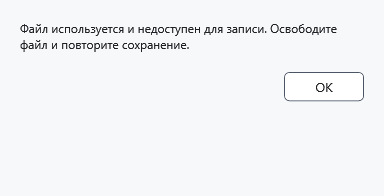

# Ошибки записи и безопасное продолжение

Сообщение об ошибке означает, что сохранение не завершено. Пока документ помечен как изменённый, не закрывайте приложение и не удаляйте исходные файлы или копии восстановления.

## Что делать

1. Прочитайте сообщение. Если файл занят, закройте программу, удерживающую его, затем повторите **Сохранить**. При отказе доступа выберите доступную папку через **Сохранить как**; при недостатке места освободите место или выберите другой диск.
2. При защищённом документе сохраните защищённый формат и нужный ключ. Отмена диалога назначения/предупреждения оставляет текущий документ несохранённым; обычный файл в другом формате может раскрыть содержимое.

3. После удачной записи убедитесь, что исчез признак изменений и указан ожидаемый путь. При сомнении откройте сохранённую копию и сравните текст/оформление.

## Что остаётся

Локальное сохранение сначала готовит результат и затем заменяет назначение; при проверенном отказе из-за занятого файла исходные байты сохраняются, а текст остаётся в редакторе. Это не гарантия при отказе накопителя, выключении питания или для любой операции на устройстве. .bak хранит предыдущую версию успешной записи; аварийный снимок — несохранённую работу; lock-снимок — защищённую работу при сбросе ключа. Ни один из них не означает успешного сохранения исходного документа.

Отмена прогресса — запрос остановки: дождитесь завершения и проверьте результаты. Пакет может быть выполнен частично; универсального Undo для записи/шифрования нет. При ошибке создания lock-снимка не закрывайте процесс со скрытой работой: сначала разблокируйте прежним ключом. Для MTP отдельно проверьте подключение, разрешения и результат на устройстве.

- [Сохранение](help:doc.save)
- [Предыдущая версия](help:recovery.backup)
- [Аварийная копия](help:recovery.crash)
- [Снимок блокировки](help:recovery.lock)
