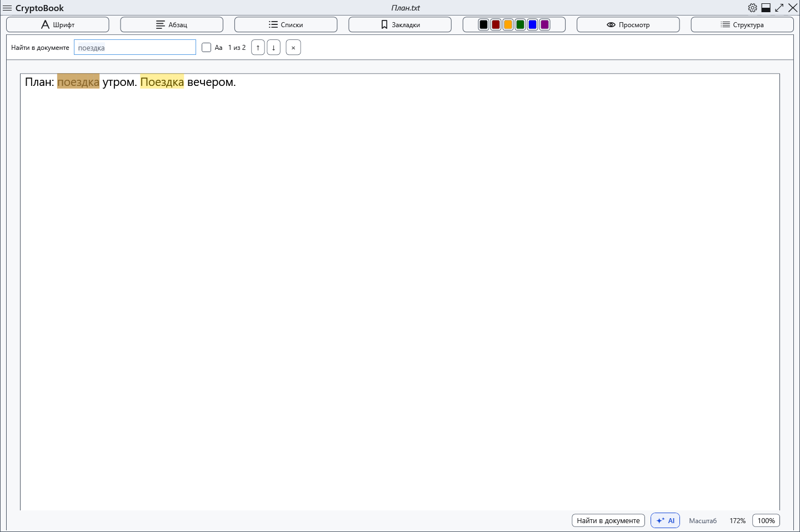
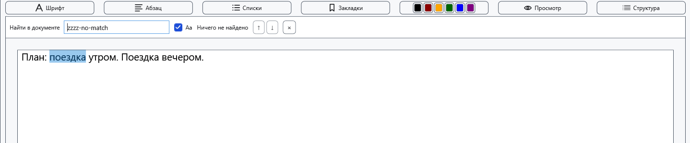
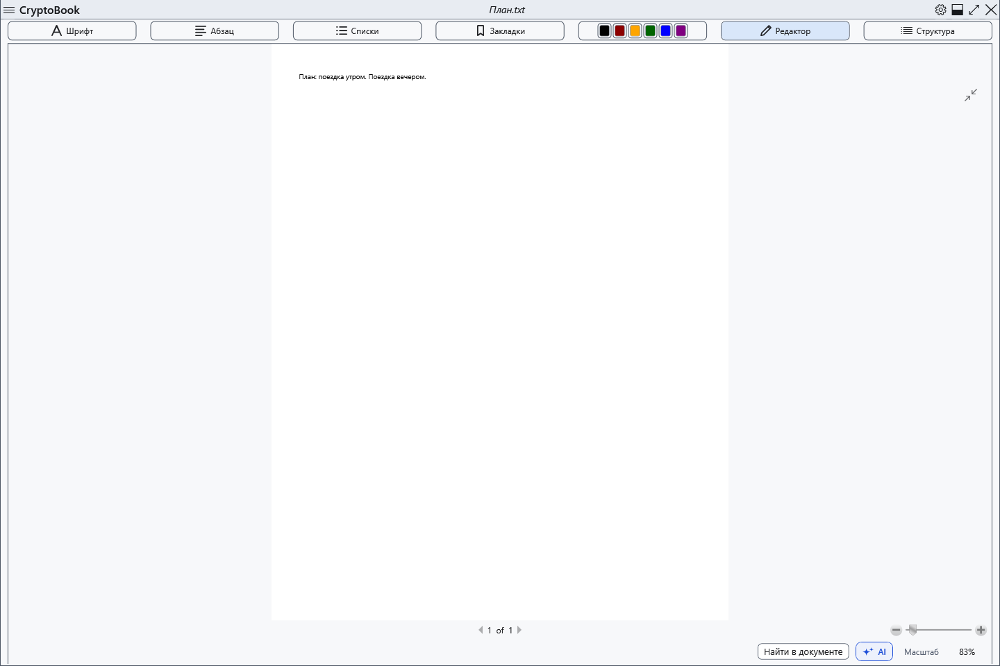
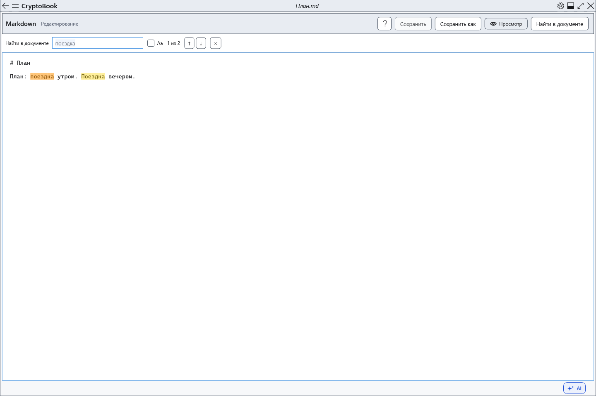
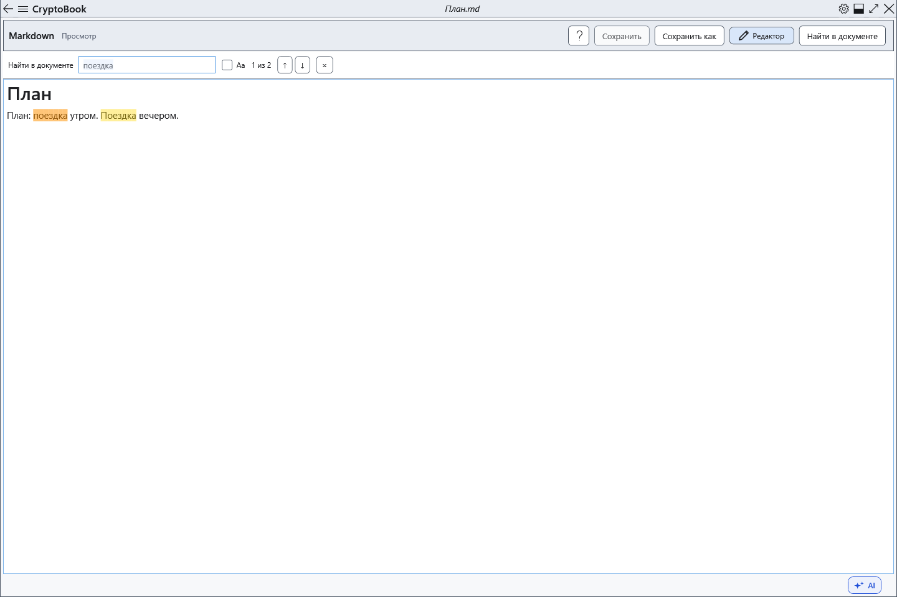

# Поиск в текущем документе

Поиск выделяет совпадения в текущем документе и показывает номер результата.

## Перед началом

Откройте нужный документ и активируйте его страницу. В Markdown исходник содержит разметку, а просмотр — отображаемый текст: набор совпадений может различаться.

В обычном документе включение постраничного просмотра закрывает поиск. Кнопка поиска или Ctrl+F из этого просмотра возвращает в режим редактирования; поиск выполняется там. В Markdown оба режима поддерживают поиск.

## Порядок действий

1. Нажмите кнопку **Найти в документе** или Ctrl+F при фокусе в области документа. Введите текст; после короткой паузы появятся подсветка и счётчик.
2. Флажок **Aa** (**Учитывать регистр**) включает учёт регистра.
3. Кнопки ↑/↓ переходят к предыдущему/следующему совпадению. В поле запроса работают Enter и Shift+Enter; при открытой панели в области документа — F3 и Shift+F3. После последнего совпадения переход продолжается с первого.
4. Нажмите × (**Закрыть поиск (Esc)**) или Esc в области документа, чтобы закрыть панель.

## Проверка результата

Текущее совпадение выделено и прокручено в видимую область. Поиск буквальный, без замены, масок или распознавания текста в картинках. При изменении текста результаты обновляются.

## Отмена и возврат

Закрытие панели убирает поисковую подсветку и возвращает фокус в редактор. Оно не изменяет текст и не отменяет сделанные правки.

## Если не получилось

При отсутствии совпадений проверьте Aa и выбранный режим Markdown. Enter вне поля запроса не является командой поиска. Ctrl+F в справке ищет по справке; в других окнах его действие зависит от фокуса.

## Связанные темы

- [Просмотр, страницы и масштаб](help:edit.view)
- [Редактирование Markdown](help:md.edit)
