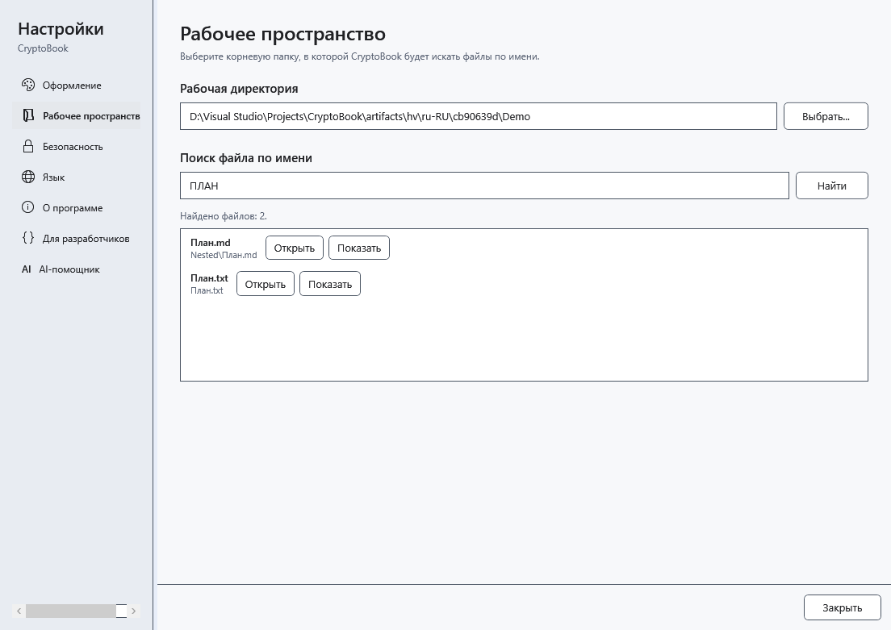

# Поиск файлов по имени

Поиск по имени находит файлы в выбранной рабочей папке и её подпапках. Он отличается от фильтра текущей папки в файловом менеджере и от поиска текста внутри документов.

## Перед началом

Выберите локальную рабочую папку. Подключённый Android не является областью этого поиска.

## Порядок действий

1. Откройте настройки и раздел **Рабочее пространство**. Проверьте путь рабочей папки.
2. В поле **Поиск файла по имени** введите часть имени, включая расширение при необходимости. Регистр букв не важен; маски и регулярные выражения не интерпретируются.
3. Нажмите **Найти** или Enter в этом поле. В результатах проверьте относительную папку.
4. Нажмите **Открыть** у нужного файла. Для просмотра его расположения используйте кнопку с подсказкой **Показать файл в Проводнике**.

## Проверка результата

Открывается выбранный файл. При внутреннем открытии документа окно настроек закрывается; внешний формат зависит от приложения Windows. Поиск возвращает до 200 файлов.

## Отмена и возврат

Измените запрос и повторите поиск либо закройте настройки. Отдельной кнопки отмены поиска по имени здесь нет. Поиск не изменяет файлы.

## Если не получилось

Нет результатов — проверьте рабочую папку и сократите часть имени. Неполный список или пропущенные папки — уточните запрос и проверьте доступ к вложенным папкам. Содержимое файла этим способом не ищется.

## Связанные темы

- [Выбрать рабочую директорию](help:start.workspace)
- [Поиск в содержимом документов](help:search.workspace)
