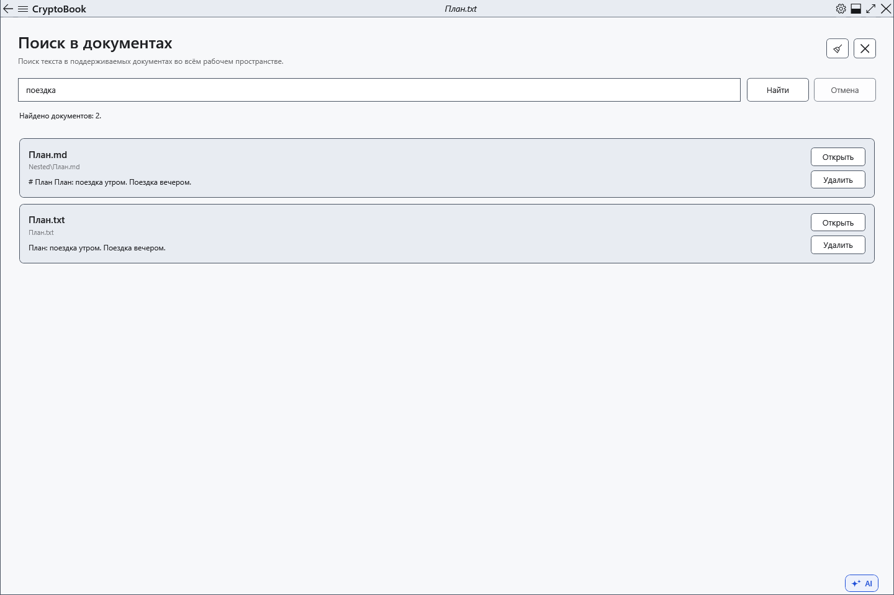
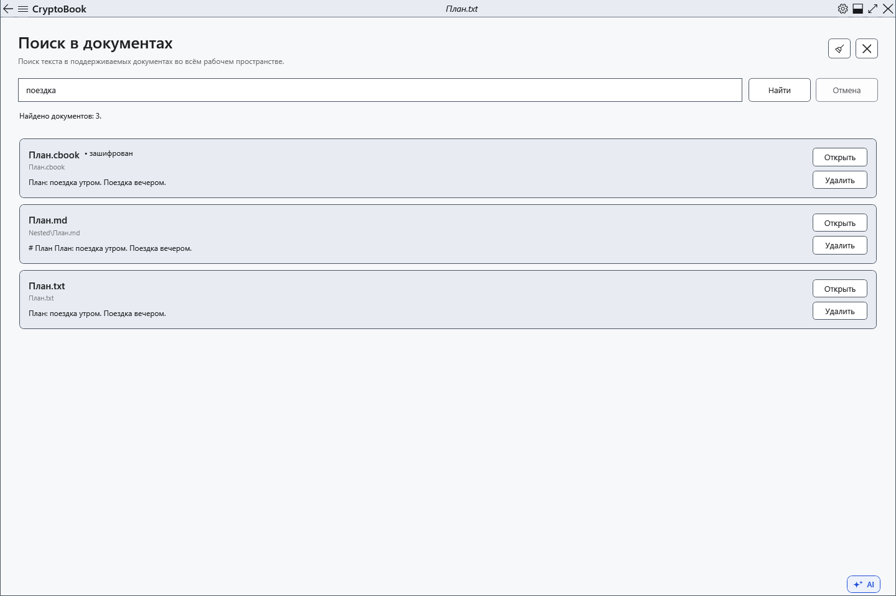

# Поиск в содержимом документов

Поиск содержимого показывает файлы с нужным текстом и фрагмент первого совпадения. Область — локальная рабочая папка со всеми доступными подпапками; несохранённый текст редактора в поиск файлов не входит.

## Перед началом

> **Удалить** в результате удаляет сам файл после подтверждения. Этот путь сейчас удаляет через провайдер напрямую; возврат из корзины Windows не предусмотрен. Для сохранения возможности возврата используйте файловый менеджер.

Поддерживаются TXT, LOG, MD, CS, XAML, JSON, XML, RTF и XamlPackage. PDF и распознавание текста изображений не поддерживаются. Обычно обрабатываются файлы до 16 МиБ; показывается до 200 результатов.

## Порядок действий

1. В боковом меню откройте **Рабочее пространство → Поиск в документах**.
2. Введите буквальный текст или фразу и нажмите **Найти**. Регистр не учитывается; слова фразы ищутся вместе. Для остановки нажмите **Отмена**.
3. Посмотрите имя, относительную папку и фрагмент. **Открыть** открывает файл, но не переводит сразу к совпадению: затем используйте поиск в документе.
4. Кнопка **Очистить** очищает запрос и выдачу; **Закрыть** возвращает к активному редактору.

## Проверка результата

Каждый найденный файл показан одной карточкой. Защищённые документы помечены отдельно. При наличии таких файлов запрашивается ключ; отмена ввода пропускает их. Защищённое содержимое ищется в памяти, без сохранения его в поисковый индекс.

Markdown ищется как сохранённый исходник, включая его разметку.

## Отмена и возврат

Отмена останавливает текущий поиск. Очистка списка не удаляет файлы. Закрытие страницы также останавливает поиск.

## Если не получилось

Сначала сохраните изменения документа. Проверьте сообщения о пропущенных, больших, неподдерживаемых или недоступных файлах. Для защищённых документов нужен подходящий ключ; не обещается поиск без него.

## Связанные темы

- [Поиск в текущем документе](help:search.document)
- [Ключ и пароль](help:security.password)
- [Два редактора, переименование и закрытие](help:doc.switch)
