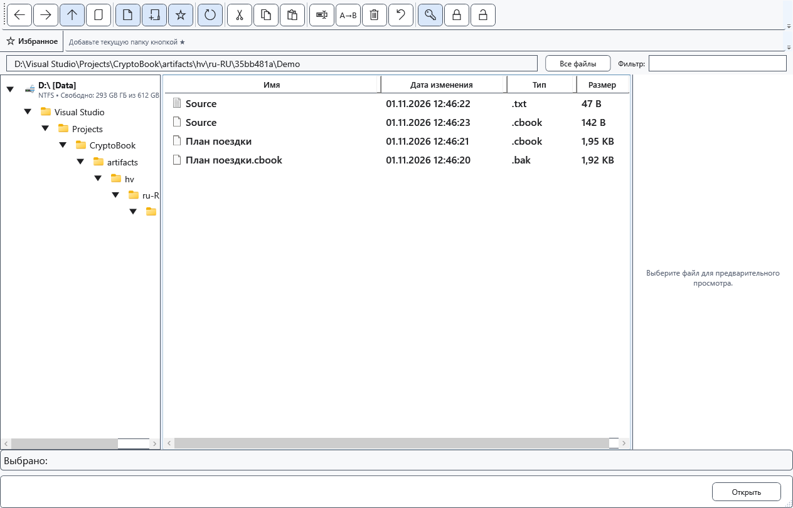

# Совместимость защищённых файлов

Имя и расширение файла не доказывают, что он защищён. CryptoBook определяет контейнер по содержимому. При шифровании на месте прежнее расширение может сохраниться; проверенные отдельные копии получают .cbook. .cbox также распознаётся как защищённый контейнер.

## Как открыть и перенести

1. Откройте файл через CryptoBook и введите исходный ключ. Новые файлы используют текущий формат; чтение прежнего формата сохранено. Переименование расширения не преобразует содержимое и не снимает пароль.
2. Сравните текст и оформление. Для редактируемого документа в защищённом файле может храниться XamlPackage; это не обычный текстовый файл. Изображения, видео и прочие двоичные файлы не становятся редактируемым текстом после защиты.
3. Для другой программы используйте явное расшифрование и подходящий исходный формат или RTF. TXT выбирайте только при согласии потерять оформление и нетекстовые элементы.

## Ключ и ошибки

Старый короткий пароль может приниматься для чтения; при новом шифровании потребуется пароль, соответствующий текущим правилам. Если меняете ключ при сохранении, проверьте также .bak: несовместимая со свежим ключом резервная копия заменяется текущим защищённым файлом и может уже не быть предыдущей версией.

При неверном ключе, повреждении или неподдерживаемом содержимом не перезаписывайте единственный экземпляр. Проверьте отдельную сохранённую копию. Пароль Windows не заменяет ключ CryptoBook; универсального восстановления забытого пароля нет. Отмена открытия оставляет файл на диске.

- [Форматы документов](help:doc.formats)
- [Расшифрование](help:security.decrypt)
- [Предыдущая версия .bak](help:recovery.backup)
