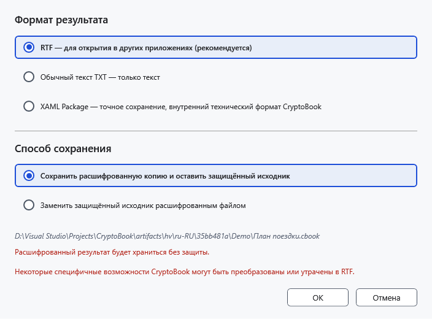
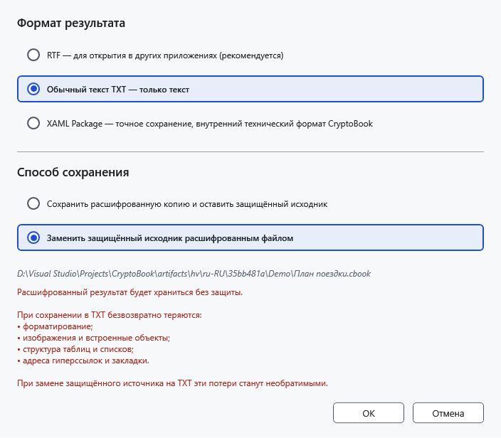

# Расшифрование файлов и папок

Расшифрованный результат доступен без ключа. Перед заменой защищённого исходника убедитесь, что хотите оставить открытые данные, и проверьте выбранный формат.

## Порядок действий

1. Выделите защищённый файл в файловом менеджере и выберите **Расшифровать выбранные элементы**. Нужен ключ, которым он был создан.
2. Для отдельного .cbook/.cbox выберите формат. **RTF — для открытия в других приложениях (рекомендуется)** предназначен для других редакторов; TXT сохраняет только текст, без изображений, таблиц и оформления. Исходный формат сохраняет исходное содержимое. Набор вариантов зависит от содержимого контейнера, а не только от его имени.
3. Выберите **Сохранить расшифрованную копию и оставить защищённый исходник** либо **Заменить защищённый исходник расшифрованным файлом**. Для первого укажите назначение; второй удаляет защищённый исходник после успешного сохранения результата и требует отдельного подтверждения.

Замена с TXT дополнительно предупреждает об утрате оформления. Не подтверждайте её, если нужны изображения или таблицы. Сохраните исходную защищённую копию для возврата.

## Папка, пакет и результат

Для папки/нескольких объектов действует отдельный выбор копии или замены. Обработка папки рекурсивна; обычные файлы при расшифровании пропускаются. При копировании существующие назначения сохраняются, конфликтующим копиям назначаются уникальные имена. Откройте результат в подходящем редакторе и проверьте текст и оформление.

На Android доступно расшифрование читаемого файла; для замены дополнительно нужны запись и удаление. Это не означает поддержку шифрования всей удалённой папки.

## Отмена и ошибки

**Отмена** в параметрах отменяет расшифрование до записи; отмена в прогрессе требует дождаться остановки. Уже завершённые элементы могут сохраниться. При неверном ключе повторите ввод исходного пароля; при ошибке записи проверьте доступ и свободное место, не удаляя контейнер до проверки результата.

- [Защита](help:security.protect)
- [Ограничения устройств](help:devices.limits)
- [Форматы](help:doc.formats)
