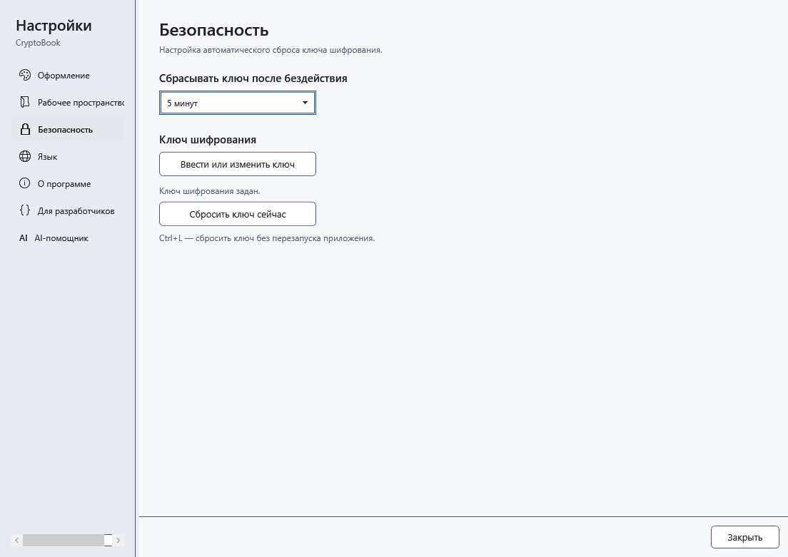
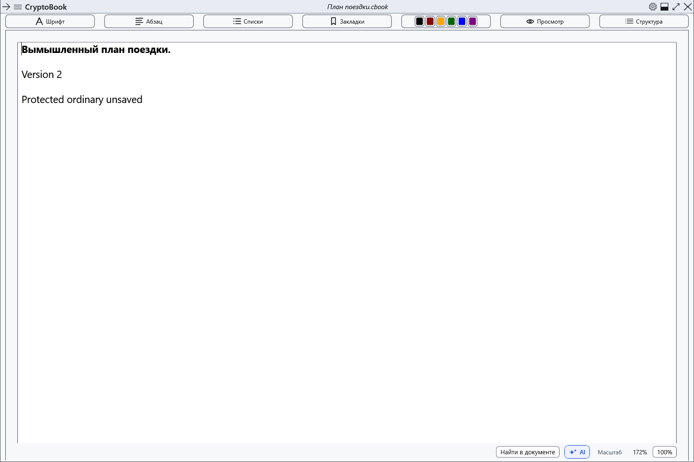

# Сброс ключа и блокировка

Ctrl+L удаляет ключ из памяти приложения. Если открыты только обычные документы, они остаются открытыми с несохранёнными изменениями: наличие ключа само по себе не делает их защищёнными.

## Как настроить

1. Откройте настройки → **Безопасность**.
2. В **Сбрасывать ключ после бездействия** выберите 1, 5, 10, 15 или 30 минут либо **Никогда**. Интервал применяется сразу; по умолчанию — 15 минут. Действия внутри CryptoBook возобновляют отсчёт, длительные файловые операции приостанавливают его.
3. Для немедленного сброса нажмите Ctrl+L в главном окне/настройках либо **Сбросить ключ сейчас**. При отсутствии ключа сбрасывать нечего. Потеря фокуса не равна сбросу; блокировка сеанса Windows и уход в сон вызывают безопасный сброс.

## Что происходит с защищённой работой

Приложение сохраняет и проверяет защищённый снимок, затем очищает ключ и защищённые редакторы. Если защищены оба независимых документа, снимок содержит оба. Если защищён только один, обычный сосед сохраняется отдельно в рабочем пространстве. Содержимое дочерних окон скрывается/закрывается, работа AI прекращается.

После успешного сброса можно продолжать обычную работу. Восстановление снимка доступно по вашей команде через боковое меню. При ошибке создания снимка ключ всё равно сбрасывается, а несохранённый защищённый документ остаётся скрытым в памяти за экраном блокировки. **Не закрывайте приложение:** разблокируйте прежним паролем и сохраните работу.

## Возврат

Откройте боковое меню → **Файл** → **Восстановить снимок после сброса ключа**. Если работа скрыта в памяти после ошибки снимка, используйте **Разблокировать**. Отмена ввода сохраняет снимок. **Никогда** отключает таймер бездействия; ручной сброс и системные события остаются.

- [Снимок блокировки и варианты возврата](help:recovery.lock)
- [Ключ](help:security.password)
- [Жизненный цикл AI](help:ai.lifecycle)
