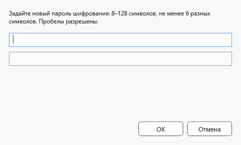
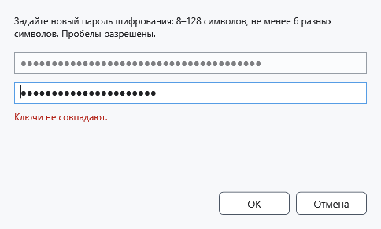

# Ключ и пароль шифрования

Ключ нужен для открытия защищённых файлов. Ввод другого ключа не меняет пароль уже сохранённых файлов. Сохраните свой пароль надёжно: CryptoBook не предлагает его сброс или восстановление по паролю Windows.

## Порядок действий

1. Откройте настройки → **Безопасность** → **Ввести или изменить ключ**. В файловом менеджере есть **Задать ключ шифрования**. При открытии защищённого файла запрос появляется автоматически, если ключа нет.
2. Для нового шифрования задайте 8–128 символов, не менее шести разных символов без учёта регистра. Пробелы разрешены; одни цифры, повторяющиеся последовательности и распространённые слабые сочетания отклоняются. Выбирайте длинный уникальный пароль.
3. Введите пароль в верхнее поле и нажмите Enter: станет доступно нижнее поле. Повторите тот же пароль и нажмите **ОК** или Enter. Символы скрыты; кнопки показа пароля здесь нет.

При несовпадении исправьте оба поля. Для чтения старого файла разрешён его прежний пароль, даже если он не подходит для нового шифрования; новое сохранение может запросить более сильный пароль.

## Результат, отмена и ошибки

В настройках появится **Ключ шифрования задан.**. Это означает наличие ключа в памяти, а не проверку всех файлов. Правильность для конкретного файла проверяется при открытии. **Отмена** закрывает ввод. Если файл не открывается, проверьте исходный пароль и целостность копии; не заменяйте единственный экземпляр. Для снятия ключа используйте Ctrl+L.

- [Защитить документы](help:security.protect)
- [Сброс ключа](help:security.lock)
- [Восстановить снимок блокировки](help:recovery.lock)
