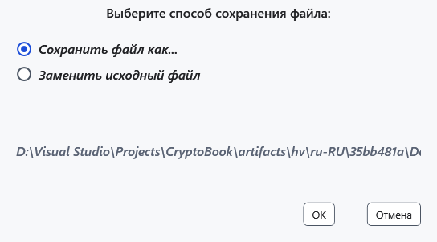
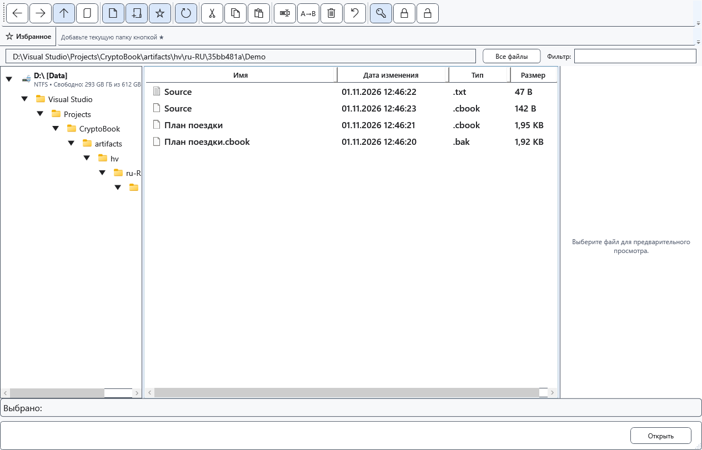

# Защита документов и файлов

Защищённая копия позволяет проверить шифрование, сохранив исходник. Обычный исходник при этом остаётся открытым для чтения. Перед заменой убедитесь, что знаете пароль и имеете отдельную нужную копию: общей отмены уже выполненного шифрования нет.

## Документ редактора

Выберите **Сохранить как**, защищённый формат .cbook и назначение. Прочитайте предупреждение и подтвердите запись; при необходимости задайте новый ключ. При сохранении обычного файла с установленным ключом приложение может предложить защищённую копию. После этого проверьте путь текущего документа: исходный обычный файл сам по себе не удаляется.

## Файлы и папки

1. В файловом менеджере выделите файлы и выберите **Создать защищённые копии (.cbook)**. Для одного файла копия создаётся рядом, для нескольких выберите папку. Результат проверяется, существующие имена сохраняются, совпадения получают уникальное имя; уже защищённые файлы пропускаются. Этот вход не предназначен для папок.
2. Для другого режима выберите **Зашифровать или заменить выбранные элементы…**. Для одного файла доступны **Сохранить файл как...** и **Заменить исходный файл**. Замена требует подтверждения.

3. Шифрование папки через эту команду выполняется на месте и рекурсивно, после предупреждения. Пакет из нескольких объектов тоже заменяет источники. Не переносите на них обещание сохранности исходников из команды защищённых копий. Целый диск шифровать нельзя; на устройстве проверяйте доступность команды отдельно.

## Проверка и отмена

Откройте полученный файл правильным ключом и сравните содержимое. При замене расширение исходного файла может сохраниться: ориентируйтесь на содержимое и успешное открытие. До подтверждения выберите **Отмена**; во время обработки запросите отмену в окне прогресса и дождитесь завершения. Завершённые элементы пакета могут остаться изменёнными. При ошибке проверьте каждый результат и права/место, сохраните исходники.

- [Расшифровать](help:security.decrypt)
- [Совместимость](help:security.compatibility)
- [Ошибки записи](help:recovery.write)
