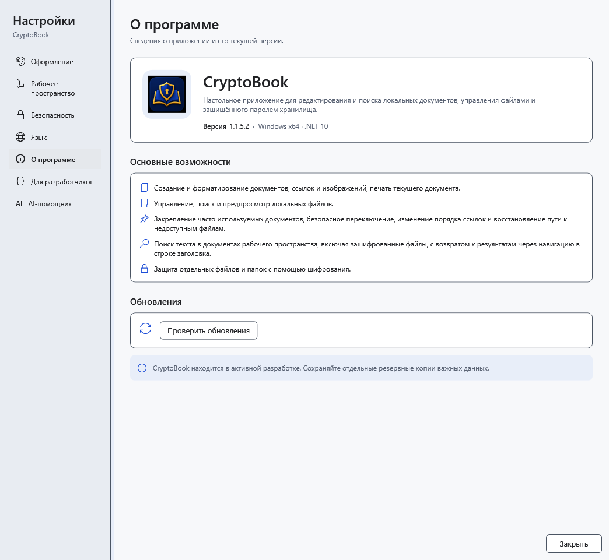
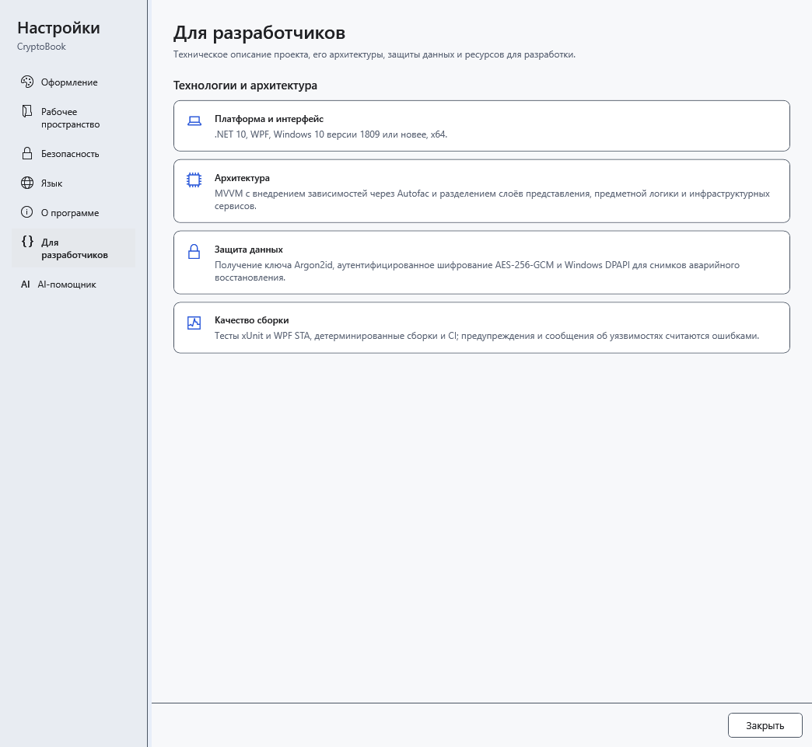

# Версия и сведения о программе

Перед обращением с проблемой узнайте версию **запущенной** программы. После запуска старой portable-папки она может отличаться от версии, которую вы недавно установили.

1. Откройте **Настройки → О программе**.
2. Найдите **Версия** рядом с названием CryptoBook. Используйте это значение в описании проблемы вместе с версией Windows и последовательностью действий.

3. Раздел **Для разработчиков** содержит сведения о платформе, архитектуре, защите и проверках проекта.

Эти сведения не являются проверкой состояния конкретного файла, компьютера или резервной копии. Здесь нет отдельного средства восстановления пароля. Проверка новой версии находится в разделе **О программе**, в блоке **Обновления**. Закройте настройки, чтобы вернуться к работе: чтение сведений не меняет документ.

- [Обновление программы](help:settings.updates)
- [Типичные проблемы](help:settings.troubleshoot)
- [Установка и portable](help:start.install)
