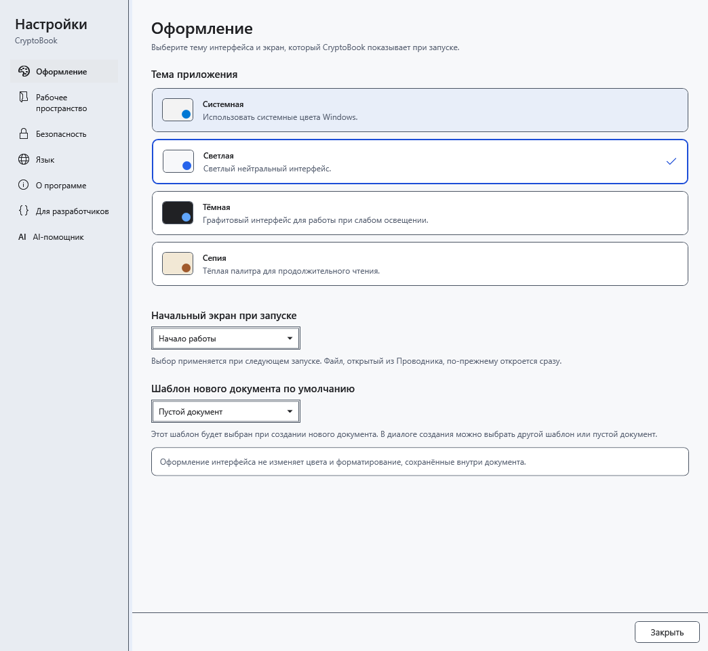
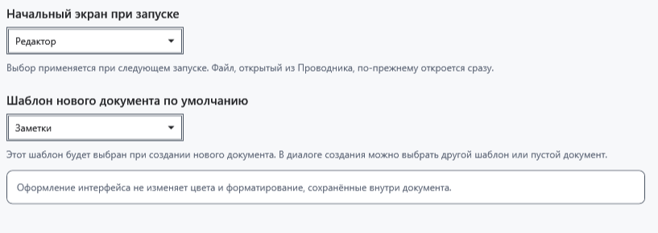

# Тема, начальный экран и шаблон

Откройте **Настройки → Оформление**. Здесь меняется вид приложения и начальный выбор для новой работы. Открытый документ сохраняет собственное оформление.

## Изменение параметров

1. Выберите **Светлая**, **Тёмная**, **Системная** или **Сепия**. Тема применяется и сохраняется сразу. Системная тема следует светлому или тёмному режиму Windows.

2. В **Начальный экран при запуске** выберите начало работы или редактор. Выбор действует при следующем запуске; открытие конкретного файла из Проводника имеет приоритет. Текущий документ не закрывается и экран немедленно не переключается.
3. В **Шаблон нового документа по умолчанию** выберите шаблон. Он будет предложен при следующем создании документа; в диалоге создания можно выбрать другой шаблон либо пустой документ.

## Проверка и возврат

Закройте и снова откройте настройки: выбор должен сохраниться. Отдельной кнопки «Применить» здесь нет; закрытие окна не отменяет выбор. Для возврата выберите прежнюю тему, экран или шаблон. Разделитель слева позволяет изменить ширину навигации настроек.

Тема не перекрашивает сохранённый текст, фон листа или изображения. Их меняйте средствами редактора; оформление AI настраивается отдельно. Если начальный экран не изменился в текущем окне, это ожидаемо: сохраните работу и проверьте обычный следующий запуск.

- [Шаблоны документов](help:doc.templates)
- [Цвета текста](help:edit.font)
- [Язык интерфейса](help:settings.language)
- [Оформление AI](help:ai.appearance)
