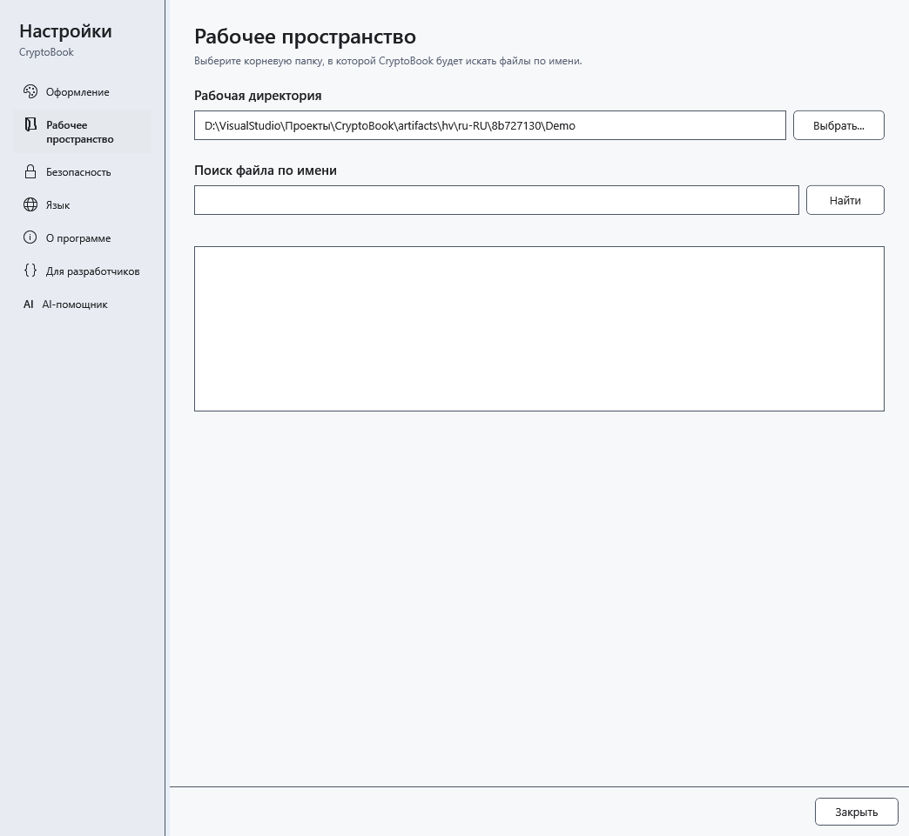

# Где хранятся данные и настройки

Рабочая директория — папка ваших документов, а не полный профиль CryptoBook. Установленная и portable-версии используют данные текущего пользователя Windows вне папки с exe.

## Что резервировать

| Данные | Где искать и что учитывать |
| --- | --- |
| Документы, защищённые файлы, `.bak` | В выбранных вами папках; `.bak` рядом с исходным файлом — одна предыдущая версия, не архив всех изменений |
| Тема, язык, начальный экран, шаблон, размеры окон и справка | `user.config` в локальном профиле Windows; подпапки зависят от версии и пути запуска программы |
| Избранное, закреплённые и недавние документы | `%LOCALAPPDATA%\CryptoBook\favorites.json`, `pinned-documents.json`, `recent-documents.json`; это ссылки и пути, не копии документов |
| Настройки AI, инструкции шаблонов и профили производительности | Там же `ai-settings.json`, `ai-runtime-profiles.json`; GGUF и mmproj остаются в выбранных вами папках |
| Проверки обновлений и пропущенный номер | Там же `update-check.json` |
| Индекс поиска обычных документов | Там же `Search\*.db`: может содержать текст обычных файлов; расшифрованный текст защищённых документов в него не записывается |
| Диагностика аварийного сохранения | Там же `Logs\recovery.log`; перед передачей отчёта проверьте его на личные пути |
| Аварийное восстановление / снимок сброса ключа | Подпапки `Recovery` / `Lock`; это разные механизмы, не замена резервной копии |

`%LOCALAPPDATA%` можно ввести в адресной строке Проводника Windows. Не редактируйте служебные файлы при работающей программе. AI-чат между запусками не сохраняется; важный ответ заранее перенесите в документ. Пароль шифрования не восстанавливается из настроек. Снимки с защитой Windows привязаны к её профилю; перенос папки на другой компьютер не гарантирует их чтение.

## Обновление и перенос

Перед обновлением сохраните и закройте приложение, скопируйте важные документы отдельно. Программа пытается перенести совместимые настройки прежней версии, но это не перенос всех данных на другой компьютер. После запуска проверьте язык, тему, рабочую папку, пути закреплённых файлов и моделей. Отсутствующая ссылка не означает удаления документа: найдите исходный файл и восстановите путь.

Служебные JSON могут содержать пути и введённые инструкции. Не публикуйте весь профиль с отчётом об ошибке. Для полного резервирования сначала закройте приложение; не удаляйте `Recovery` или `Lock` до проверки восстановления. Временные файлы загрузки обновлений находятся в `%TEMP%\CryptoBook\Updates`, а не в рабочей папке.

- [Обновление](help:settings.updates)
- [Аварийное восстановление](help:recovery.crash)
- [Снимок сброса ключа](help:recovery.lock)
- [Шаблоны AI](help:ai.templates)
- [Закреплённые документы](help:files.pinned)
