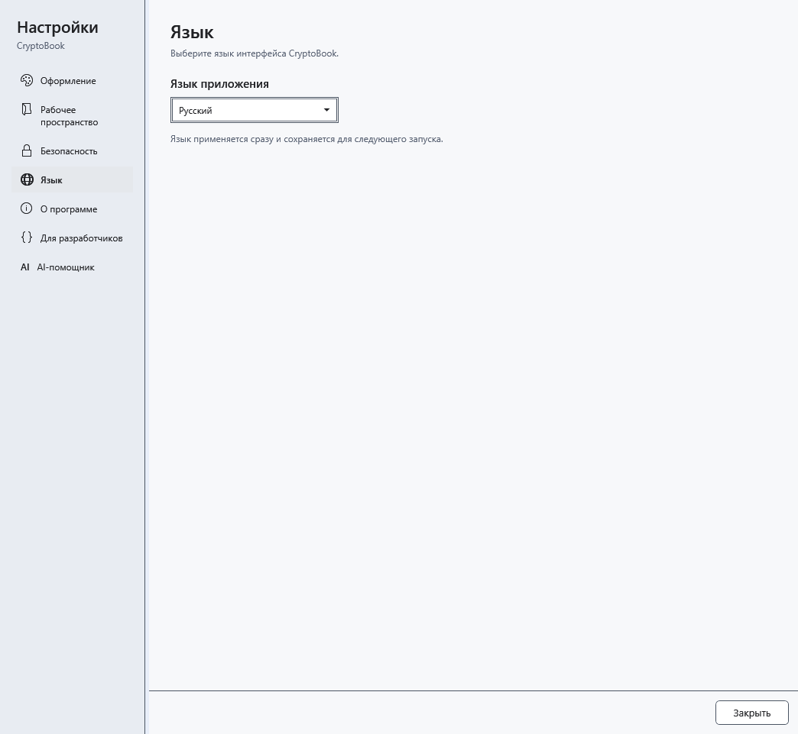

# Язык приложения и справки

CryptoBook поддерживает English, Русский, Українська и Deutsch. Выбор меняет интерфейс и встроенную справку; введённый вами текст и ответы AI автоматически не переводятся.

1. Откройте **Настройки → Язык**.
2. В **Язык приложения** выберите нужный язык. Он применяется сразу и сохраняется для следующего запуска.

## Что происходит с открытой справкой

Текущая тема остаётся той же, но отображается её перевод. Поисковый запрос и результаты очищаются, прокрутка статей в истории возвращается к началу. Это предотвращает переходы по результатам на прежнем языке. Введите запрос на новом языке заново.

Закрытие настроек не отменяет выбор; верните прежний язык тем же списком. Если слово осталось прежним, проверьте, является ли оно содержимым документа, названием файла, модели или собственным именем: такие данные не переводятся. Для ответа AI на другом языке измените инструкцию в шаблоне общения.

- [Пользование справкой](help:help.use)
- [Оформление приложения](help:settings.appearance)
- [Шаблоны общения AI](help:ai.templates)
