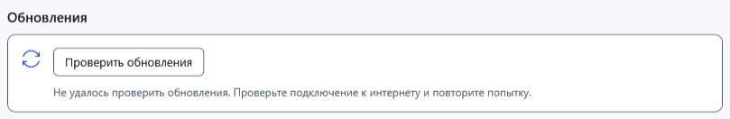

# Типичные проблемы и безопасные действия

Сначала сохраните доступную работу отдельно, запишите точное сообщение, версию программы и шаги. Не удаляйте исходный файл, `.bak`, `Recovery` или `Lock` ради устранения непонятной ошибки. Для проверки используйте копию обычного документа.

| Признак | Что проверить и сделать |
| --- | --- |
| Кнопка недоступна | Активный документ, выделение, режим чтения и текущую операцию. Для группового переименования нужны минимум два подходящих файла. Верните фокус в нужное окно |
| Не удаётся сохранить | Свободное место, права записи, доступность папки и блокировку другим приложением. Попробуйте сохранить в другой доступной папке; исходник не удаляйте |
| Документ открывается иначе | Уточните расширение: TXT не сохраняет оформление, Markdown хранит исходный текст. Проверьте режим предпросмотра и выбранный редактор |
| Ссылка в недавних или закреплённых недоступна | Диск мог отключиться, файл — переместиться. Подключите источник или восстановите путь; запись списка не является копией файла |
| Защищённый файл не открывается | Проверьте выбранный файл и пароль. Неверный ключ, повреждение и несовместимый формат требуют разных действий; смена расширения не расшифровывает файл. Пароль из настроек не извлекается |
| Пропала работа после сброса ключа | Используйте команду восстановления снимка из меню Файл и прежний ключ; при ошибке снимка не закрывайте процесс до возврата скрытой работы |
| Android не виден | Разблокируйте устройство, включите передачу файлов USB/MTP, проверьте кабель и подключение. Не повторяйте перемещение вслепую: проверьте оба конца операции |
| PDF или видео не открывается | Для PDF нужна ассоциированная программа Windows; для видео важны формат и доступность источника. Отсутствие системного обработчика не исправляется сменой пароля |
| AI не отправляет или не загружается | Прочитайте причину недоступности и состояние модели; проверьте GGUF, подходящий проектор для изображения, контекст и память. Не перезапускайте ответ многократно без проверки причины |
| Справка не находит слово | Выберите язык, сократите запрос, используйте слова статьи. Поиск справки отделён от поиска документов и файлов; кнопка оглавления очищает запрос |

При ошибке обновления проверьте сеть, GitHub, права и место во временной папке. При несовпадении суммы или ошибке подписи не запускайте файл вручную. Если настройки выглядят сброшенными после перехода между portable-папками, проверьте запущенную версию и прежний профиль; не удаляйте старые данные до проверки.

Для сообщения о проблеме достаточно версии, последовательности, формата и обезличенного примера. Не прикладывайте пароль, ключ, весь профиль, личные документы или чат.

- [Ошибки записи](help:recovery.write)
- [Ограничения устройств](help:devices.limits)
- [Ошибки AI](help:ai.troubleshoot)
- [Обновление](help:settings.updates)
- [Пользовательские данные](help:settings.data)
