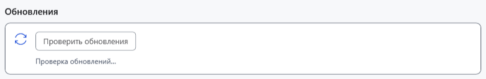
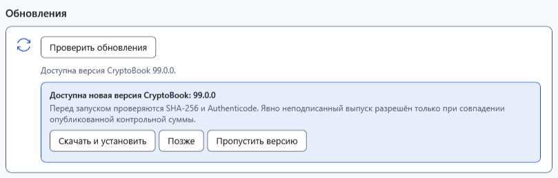

# Проверка и установка обновления

Проверка узнаёт о новой стабильной версии; установка отдельно скачивает и запускает установщик. Перед установкой сохраните все обычные и Markdown-документы и отдельно скопируйте важные файлы. Чат AI не сохраняется между запусками.

## Проверить версию

1. Откройте **Настройки → О программе** и найдите **Обновления**; при необходимости прокрутите вниз.
2. Нажмите **Проверить обновления**. Во время **Проверка обновлений…** дождитесь результата.

При отсутствии новой версии появится **Установлена последняя версия CryptoBook.**. Фоновая проверка выполняется при запуске, если с предыдущей прошло не менее 24 часов; это не постоянный таймер. Ручная проверка обходит этот интервал и ранее пропущенную версию.

## Выбрать действие

- **Позже** скрывает текущее уведомление, не записывая пропуск версии.
- **Пропустить версию** сохраняет именно этот номер и скрывает его при фоновых проверках. Другую новую версию это не блокирует.
- **Скачать и установить** загружает установщик. Проверяются адреса файлов выпуска, SHA-256 и состояние Authenticode. Явно неподписанный выпуск допускается при совпадении суммы; недействительная подпись или несовпадение суммы отклоняются. Затем запускается установщик с повышением прав, а приложение завершает работу. Для старого источника без файла установщика команда может открыть страницу выпуска вместо установки.

Встроенное обновление использует установщик и при запуске portable. Для обновления через ZIP следуйте отдельной инструкции установки. Загрузка использует временную папку Windows; отмена или ошибка прерывает операцию и удаляет незавершённый `.download`. Отмена после запуска отдельного установщика уже относится к его окну. После успешной установки запустите CryptoBook и проверьте версию, настройки и документы.

## Если проверка или установка не удалась

При **Не удалось проверить обновления. Проверьте подключение к интернету и повторите попытку.** проверьте доступ к интернету/GitHub и повторите позже. Для ошибки загрузки проверьте место в TEMP и разрешения. При отказе проверки целостности не запускайте скачанный файл вручную: повторите загрузку из доверенного источника. Отказ UAC не устанавливает обновление. Не удаляйте профиль или документы для устранения ошибки обновления.

- [Установка и portable](help:start.install)
- [Пользовательские данные](help:settings.data)
- [Сохранение документов](help:doc.save)
- [Типичные проблемы](help:settings.troubleshoot)
